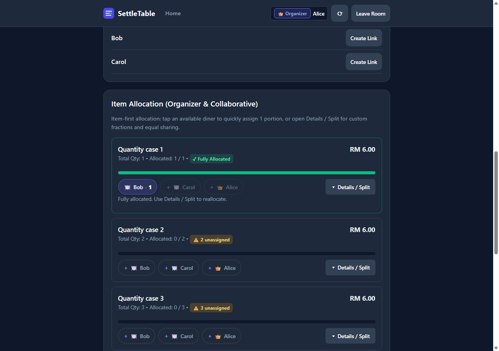
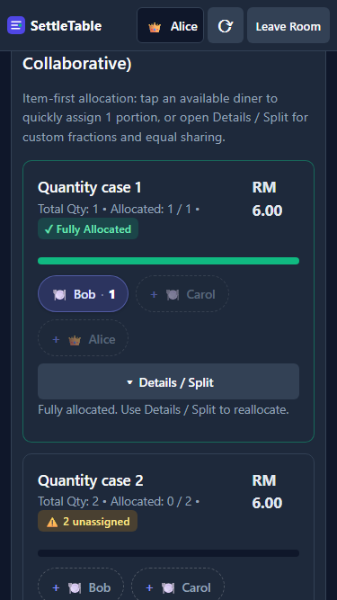
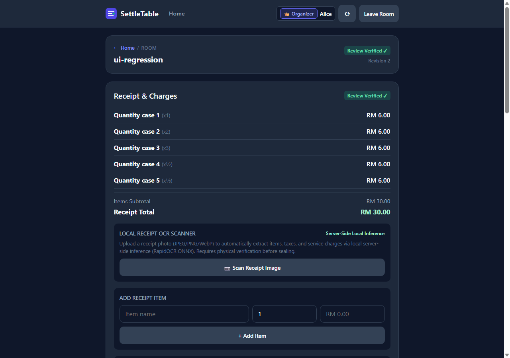
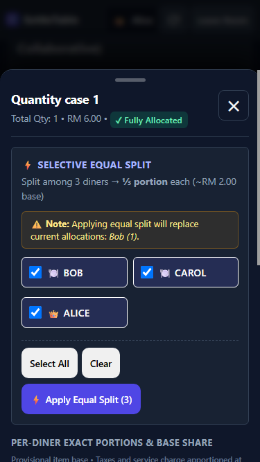

# SettleTable

> **Deterministic, cent-conserving dining bill apportionment with local offline receipt OCR, real-time multi-diner collaboration, and optional Notion reporting.**

[](https://github.com/KAIYI7/settle-table/actions/workflows/python-tests.yml)
[](https://www.python.org/)
[](THIRD_PARTY_NOTICES.md)
[](settletable/static/)

---

## Overview

Splitting restaurant dining bills among friends is notoriously frustrating: tax, service charges, discounts, and rounding adjustments make manual math prone to errors and fractional penny drift. Existing apps often take shortcuts (equal tax division, floating-point roundoff errors, or mandatory cloud AI uploads that expose private dining receipts).

**SettleTable** solves this with absolute mathematical precision and strict data privacy:
1. **Mathematical Cent Conservation**: Every single cent (`sen`) of subtotal, tax, service charges, discounts, and rounding is conserved and accounted for using largest-remainder apportionment (`tabwise-apportion-v1`).
2. **Air-Gapped Local OCR**: RapidOCR runs entirely on the host CPU via ONNX Runtime. Zero images or private receipt data are ever transmitted to third-party hosted vision APIs.
3. **Multi-Diner Real-Time Collaboration**: Diners join via private pre-minted invitation links or general meal join requests with organizer authorization.
4. **Multi-Payer Contributions & Net Balance Reconciliation**: Tracks who paid what at the cashier (cash, card, e-wallet, bank transfer) and computes exact net balances ($\text{Contributed} - \text{Consumed}$).
5. **Greedy Peer Settlement Suggestions**: Minimizes the number of reimbursement transfers needed to settle all debts and tracks partial repayments until zero balances are achieved.
6. **Optional Downstream Notion Export**: Finalized meals can be exported into rich Notion database tables along with the original receipt photo.

---

## Screenshots & User Experience

| Desktop Allocation & Review | Mobile Responsive Diner View |
|:---:|:---:|
|  |  |

| Receipt Review & Quantities | Mobile Capacity Details |
|:---:|:---:|
|  |  |

---

## Key Verified Features

- **Integer Minor-Unit Financial Engine**:
  - Implemented in standard-library Python (`settletable/calculation.py`).
  - Strict integer `sen` representations prevent floating-point inaccuracies.
  - Rational fractions (`Fraction`) for fractional item quantities (e.g. sharing $\frac{1}{2}$ or $\frac{1}{3}$ of a pizza).
  - Largest-remainder apportionment guarantees $\sum \text{diners' shares} = \text{receipt total}$ to the exact cent.
  - Supports RM0.00 complimentary items (e.g. warm water) without mandatory portion claiming.

- **Local Receipt OCR & Malaysian Restaurant Parser**:
  - Offline CPU inference with RapidOCR (`PP-OCRv6`).
  - Specialized heuristic parser for Malaysian dining receipts: detects Service Tax (SST 6%/8%), Service Charge (10%), discounts, item lines, and rounding.
  - Staged Candidate Editor: organizers can review and adjust recognized item names, quantities, and prices before applying them.

- **Receipt Photo Retention & Modal Zoom**:
  - Original receipt photos are stored with crash-consistent atomic filesystem guarantees and recorded in SQLite.
  - Interactive pan-and-zoom viewer modal with mouse wheel and drag gesture support.

- **Multi-Payer & Peer Reimbursement Tracking**:
  - Multiple diners can contribute toward the restaurant cashier bill.
  - Automated calculation of optimal peer-to-peer transfers.
  - Records confirmed reimbursements, tracks partial balances, and supports reversing invalid entries.

- **Strict Two-Tier Ingress Security**:
  - Ingress reverse proxy enforces raw wire stream protection and blocks remote meal bootstrap calls.
  - WSGI transport adapter enforces exact-origin CSRF checks (`X-SettleTable-Action: 1`), host-only `HttpOnly; SameSite=Strict` session cookies, and path/token redaction in all logs.

- **Zero-Dependency Vanilla Frontend**:
  - Written in modern vanilla ES2022, HTML5, and CSS3 (`settletable/static/`).
  - Zero external CDN dependencies, zero npm build steps, zero tracking scripts.
  - Fully responsive from 320px mobile screens to large desktop monitors.

---

## Architecture & Technology Stack

```
┌────────────────────────────────────────────────────────────────────────┐
│                        Untrusted Web Browsers                          │
│        (Desktop Chrome/Edge, Mobile Android/iOS Safari Chrome)         │
└───────────────────────────────────┬────────────────────────────────────┘
                                    │ Public HTTPS (TLS Termination)
                                    ▼
┌────────────────────────────────────────────────────────────────────────┐
│               TIER 1: Ingress Reverse Proxy (Caddy / Nginx)            │
│  - Raw wire buffer bounds (Slowloris stream defense)                   │
│  - Block external access to: POST /api/meals/*/bootstrap               │
│  - Static asset caching and HTTP/2 compression                         │
└───────────────────────────────────┬────────────────────────────────────┘
                                    │ Local loopback / Unix socket
                                    ▼
┌────────────────────────────────────────────────────────────────────────┐
│             TIER 2: SettleTable WSGI App (Gunicorn / Waitress)         │
│  - settletable.transport: Host checks, exact-origin CSRF validation    │
│  - settletable.authority: Deterministic state machine & SQLite WAL     │
│  - settletable.calculation: Cent-conserving apportionment core         │
│  - settletable.funding & settlement: Multi-payer & peer transfers     │
│  - settletable.ocr: Local CPU ONNX inference (RapidOCR)                │
│  - settletable.notion: Asynchronous background Notion exporter         │
└───────────────────┬────────────────────────────────┬───────────────────┘
                    │                                │
                    ▼                                ▼
       ┌────────────────────────┐       ┌────────────────────────┐
       │   SQLite WAL Database   │       │ Receipt Photo Storage  │
       │ (/data/settletable.db) │       │ (/data/receipt_photos) │
       └────────────────────────┘       └────────────────────────┘
```

| Layer | Technologies | Key Design Invariants |
|---|---|---|
| **Frontend** | Vanilla ES2022, HTML5, CSS3 | Zero CDNs, host-only cookies, container queries, 44px mobile touch targets, `prefers-reduced-motion` compliance. |
| **Transport** | Python WSGI (`SettleTableApp`) | Two-tier ingress security, loopback bootstrap protection, strict JSON grammar, integer digits bounds ($\le 19$), token log redaction. |
| **State & Authority** | Python standard library, SQLite | Single-instance SQLite in WAL mode (`PRAGMA busy_timeout=1000`), crash-consistent photo retention, optimistic revision locking. |
| **Financial Core** | Pure Python (`settletable.calculation`) | Integer minor units (`sen`), rational fractions, largest-remainder cent conservation (`tabwise-apportion-v1`). |
| **OCR Pipeline** | RapidOCR, ONNX Runtime (CPU) | 100% offline local inference, Malaysian SST/service charge parser, pre-cached models, zero cloud vision calls. |
| **Export** | Decoupled REST (`settletable.notion`) | Optional asynchronous background worker, token scrubbing, redirect protection against credential leakage. |

---

## Getting Started (Local Development)

### Prerequisites
- Python 3.10, 3.11, 3.12, 3.13, or 3.14
- Modern web browser (Chrome, Edge, Firefox, Safari)

### Quick Start (Demo Mode with Mock Clients)

Clone the repository and launch the local demo server:

```bash
# Clone the repository
git clone https://github.com/KAIYI7/settle-table.git
cd settle-table

# Launch the demo server with deterministic mock OCR and Notion
python tools/run_demo.py --host 127.0.0.1 --port 8000 --mock-ocr --mock-notion
```

Open `http://127.0.0.1:8000` in your web browser.

---

## Setting Up Real Local OCR

To run actual optical character recognition on your local machine using RapidOCR on CPU:

1. Create and activate a virtual environment:
   ```bash
   python -m venv .venv-ocr

   # On Windows PowerShell:
   .\.venv-ocr\Scripts\Activate.ps1

   # On Linux / macOS:
   source .venv-ocr/bin/activate
   ```

2. Install pinned OCR dependencies:
   ```bash
   pip install -r requirements-ocr.txt
   ```

3. Launch the server with real OCR enabled:
   ```bash
   python tools/run_demo.py --host 127.0.0.1 --port 8000 --mock-notion
   ```
   *(RapidOCR will cache its lightweight ~15–20 MB ONNX models locally upon first receipt scan).*

For detailed OCR architecture and troubleshooting, see [Local OCR Setup Guide](docs/ocr-setup.md).

---

## Production Deployment Preparation

SettleTable is packaged as a reproducible, single-instance container application.

### Important Production Invariants
1. **Single-Instance Requirement**: Because SettleTable uses SQLite in WAL mode, the application **must run as exactly one instance**. Horizontal autoscaling across multiple containers is prohibited.
2. **Loopback Bootstrap Protection**: `POST /api/meals/{id}/bootstrap` is blocked from external calls. Meals in hosted environments are provisioned via administrative CLI (`tools/bootstrap_meal.py`).
3. **Exact Origin Configuration**: You must set `SETTLETABLE_SERVER_ORIGIN` to your public HTTPS domain; otherwise, client mutations will fail CSRF origin validation.

### Deployment Options

- **Option A: Container Deployment (Docker Compose + Caddy)**
  ```bash
  # Copy and configure environment variables
  cp deploy/env.template .env
  # Edit .env with your domain (e.g. SETTLETABLE_SERVER_ORIGIN=https://settletable.example.com)

  # Launch with Caddy automatic TLS
  docker compose --profile with-caddy up -d
  ```

- **Option B: Managed PaaS (Fly.io)**
  - Use `shared-cpu-1x` (1 GB RAM) or `shared-cpu-2x` (2 GB RAM).
  - Attach a persistent NVMe volume (`fly volumes create settletable_data --size 3`).
  - Pin to 1 machine (`min_machines_running = 1`, `auto_stop_machines = false`).

- **Option C: Small VPS (Hetzner Cloud CX22 / DigitalOcean Droplet)**
  - 2 vCPU, 2–4 GB RAM, NVMe SSD.
  - Deploy via Docker Compose with Caddy reverse proxy.
  - Estimated cost: **~$4.10 / month**.

### Administrative Meal Provisioning

Because public clients cannot call the bootstrap endpoint, provision meals directly on the host:

```bash
python tools/bootstrap_meal.py --meal-id dinner-friday --organizer "Alice" --diners "Bob, Charlie"
```
The CLI outputs the organizer's session token and diner invitation links.

### Hot Backup & Disaster Recovery

Perform live, crash-consistent hot backups while the server is actively running:

```bash
# Hot backup SQLite WAL database and receipt photos
python tools/backup_restore.py backup --db /data/settletable.sqlite --out-dir /data/backups

# Disaster recovery restore from a backup manifest
python tools/backup_restore.py restore --manifest /data/backups/manifest_TIMESTAMP.json --dest-db /data/settletable.sqlite
```

---

## Testing & Verification

SettleTable includes extensive automated test coverage across mathematical correctness, state machine transitions, adversarial security, and end-to-end browser journeys:

```bash
# Run all Python unit, calculation, and security tests (294 tests)
python -m unittest discover -s tests -v

# Run transport adapter unit tests
python -m unittest tests.test_transport

# Run live deployment smoke check
python tools/deployment_smoke_check.py --url http://127.0.0.1:8000

# Run automated Chrome CDP browser regression suites (requires Chrome & Node.js)
node tools/e2e_browser_test.mjs
node tools/verify_multi_payer_flow.mjs
node tools/verify_peer_settlement_flow.mjs
node tools/verify_conflict_recovery.mjs
node tools/verify_complimentary_items_flow.mjs
node tools/verify_context_aware_navigation.mjs
node tools/verify_mobile_ux_remediation.mjs
```

---

## Deep Technical Documentation

- [Release & Deployment Plan](docs/plans/MVP_RELEASE_AND_DEPLOYMENT.md) — Comprehensive release readiness audit, hosting evaluation, and acceptance gates.
- [Account Identity & "My Meals" Roadmap](docs/plans/ACCOUNT_IDENTITY_AND_MY_MEALS.md) — Future architecture for persistent accounts and meal discovery.
- [Deployment Boundary & Threat Model](docs/deployment-boundary.md) — Ingress specifications and two-tier security boundaries.
- [Security Policy](SECURITY.md) — Vulnerability reporting and defense-in-depth guarantees.
- [Changelog](CHANGELOG.md) — Complete revision history across all pull requests.
- [Domain Glossary](GLOSSARY.md) — Canonical terminology, invariants, and rounding contracts.
- [User Acceptance Testing Guide](docs/uat-handover.md) — Step-by-step UAT verification scenarios.

---

## Known Limitations & Roadmap

- **Organizer Recovery**: Currently, an organizer session is tied to their browser cookie issued at bootstrap. If an organizer clears their browser cookies before finalization, organizer authority cannot be recovered without database access. The future Account & Login roadmap addresses this.
- **Single-Instance Deployment**: SettleTable cannot be horizontally autoscaled across multiple servers due to SQLite WAL concurrency boundaries.
- **Offline Phone Processing**: OCR inference runs on the host server CPU, not on-device inside client mobile browsers.

---

## Licensing & Intellectual Property

SettleTable is **Copyright © 2026 Kai Yi. All Rights Reserved.**

This repository is currently source-available for inspection, self-hosting, and evaluation. No project-wide open-source license (such as MIT or Apache 2.0) has been granted. Third-party components and skills retain their respective upstream licenses as documented in [THIRD_PARTY_NOTICES.md](THIRD_PARTY_NOTICES.md).
