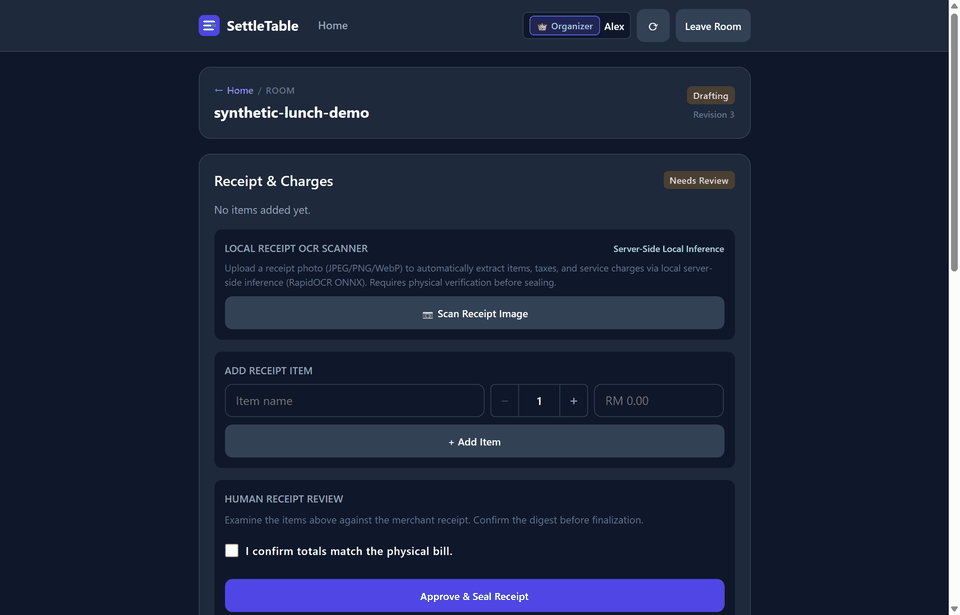
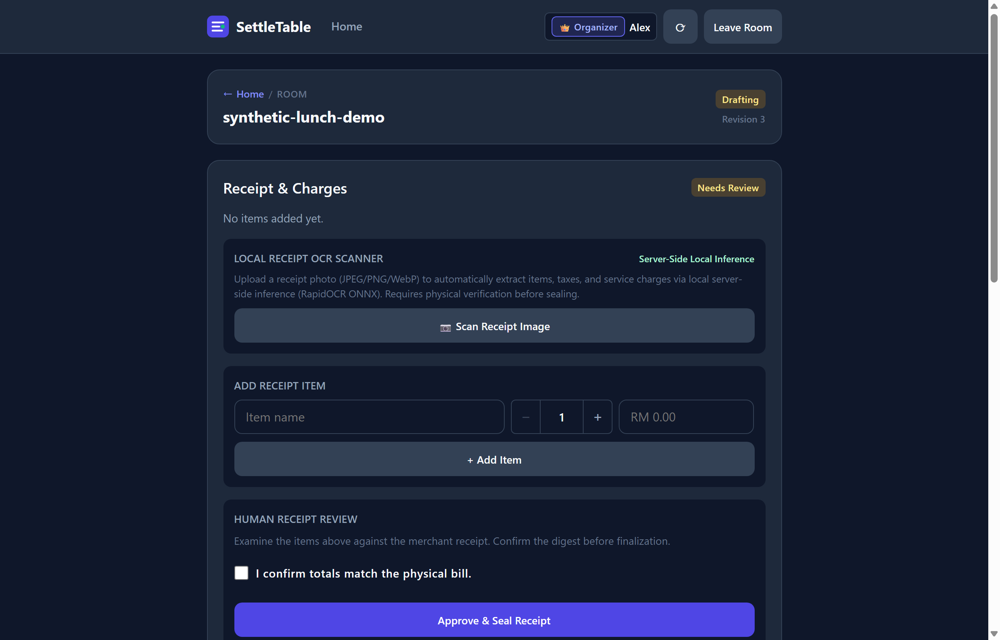
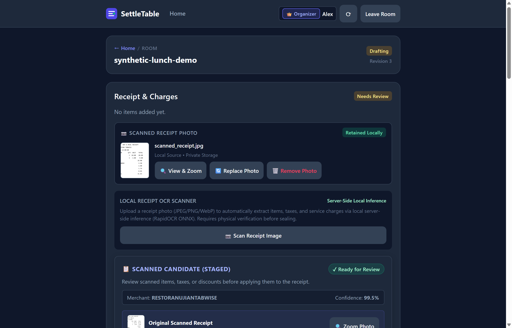
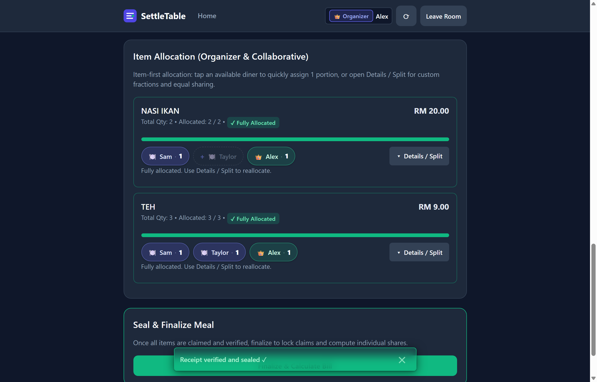
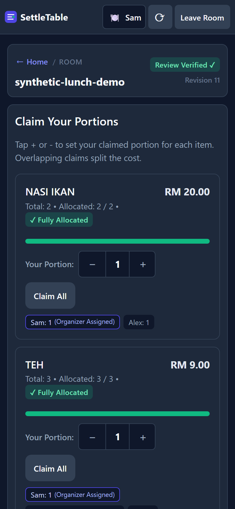
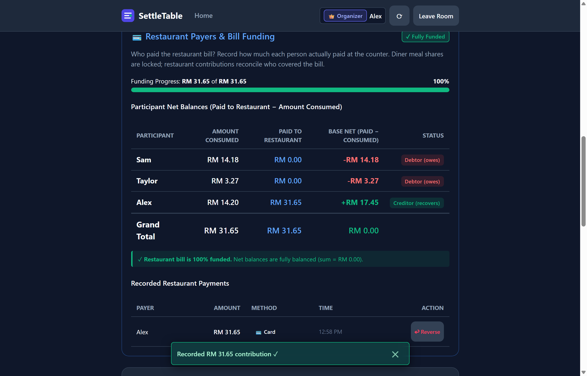
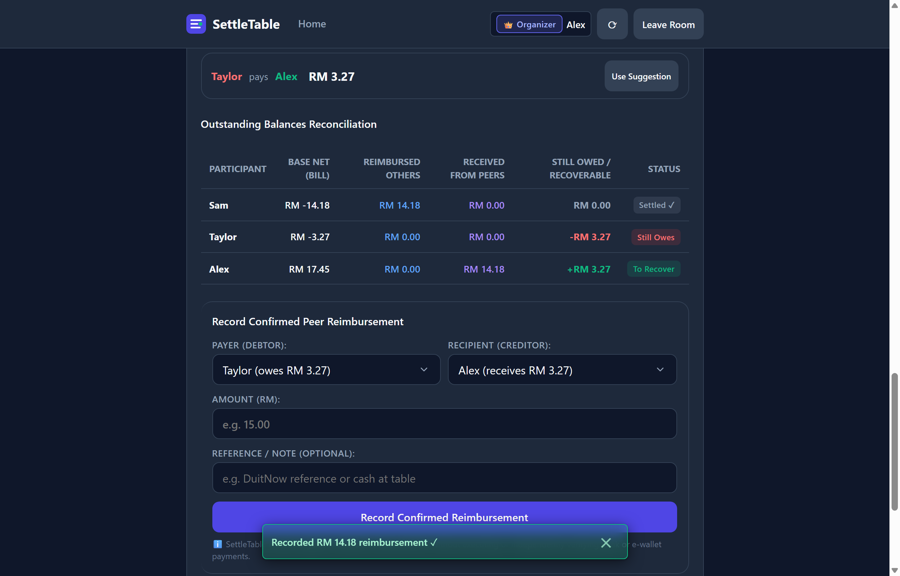

# SettleTable

> **Deterministic, cent-conserving dining bill apportionment with local offline receipt OCR, real-time multi-diner collaboration, and verified encrypted disaster recovery.**

[](https://kaiyi7.github.io/settle-table/)
[](https://github.com/KAIYI7/settle-table/actions/workflows/python-tests.yml)
[](https://www.python.org/)
[](THIRD_PARTY_NOTICES.md)
[-brightgreen.svg)](settletable/static/)
[](deploy/cloudflare/)

---

### Quick Evaluation Links

- **Always-Accessible Project Showcase**: **[https://kaiyi7.github.io/settle-table/](https://kaiyi7.github.io/settle-table/)** &mdash; Interactive visual demonstration, architecture breakdown, and verified testing evidence (hosted 24/7 on GitHub Pages).
- **Public GitHub Repository**: **[https://github.com/KAIYI7/settle-table](https://github.com/KAIYI7/settle-table)** &mdash; Full source code, test suites, and operational runbooks.
- **On-Demand Hosted Application**: **[https://settle.kybuilds.com](https://settle.kybuilds.com)** &mdash; Self-hosted via Cloudflare Named Tunnel during active dining sessions (returns `HTTP 530 / Error 1033` when host connector is offline).

---

## Overview

Splitting restaurant dining bills among friends is notoriously frustrating: tax, service charges, discounts, and rounding adjustments make manual calculations error-prone and vulnerable to fractional-penny drift. Existing consumer applications often take shortcuts—such as equal tax division, floating-point rounding errors, or mandatory cloud AI uploads that expose private dining receipts to third-party providers.

**SettleTable** is a self-hosted, single-instance dining expense management system engineered for mathematical precision, privacy, and zero-friction guest participation:

- **Mathematical Cent Conservation**: Every cent (`sen`) of subtotal, tax, service charges, discounts, and rounding adjustments is conserved and accounted for using largest-remainder apportionment (`tabwise-apportion-v1`).
- **100% Offline Local OCR**: Optical character recognition runs on the host CPU using RapidOCR via ONNX Runtime. Zero images or dining receipts are ever transmitted to third-party vision APIs.
- **Zero-Install Diner Collaboration**: Diners participate from mobile browsers using single-use fragment links (`/#/invite/<token>`) that keep tokens out of HTTP request lines and CDN access logs.
- **Multi-Payer Cashier Reconciliation**: Records who contributed toward the cashier bill (cash, card, e-wallet, bank transfer) and computes exact net balances ($\text{Contributed} - \text{Consumed}$).
- **Greedy Peer Settlement Suggestions**: Heuristically computes suggested reimbursement transfers to reduce transaction overhead and tracks partial repayments until all net balances reach RM0.00.
- **Disaster Recovery & Encrypted Cloud Mirroring**: Quiescent SQLite write-lock snapshots, SHA-256 manifests, AES-256 header encryption (`7z -mhe=on`), and verified Google Drive cloud mirroring.
- **On-Demand Public Ingress**: Publicly accessible via Cloudflare Named Tunnel at **`https://settle.kybuilds.com`** during active sessions, with immediate local host deactivation.

> [!NOTE]
> **Live Deployment Availability**: Public access (`https://settle.kybuilds.com`) operates on-demand during supervised dining sessions and testing events. When the Windows host or Cloudflare connector is inactive, the public endpoint returns `HTTP 530 / Cloudflare Error 1033` (Tunnel Disconnected), preserving host resources and privacy.

---

## Screenshots & Recruiter Walkthrough

*All screenshots and recordings originate from automated Chrome CDP runs against the working application using sanitized synthetic fixtures.*

<p align="center">
  
</p>

| 1. Organizer Room Setup | 2. Staged OCR Candidate Review |
|:---:|:---:|
|  |  |

| 3. Granular Portion Allocation | 4. Mobile Diner View |
|:---:|:---:|
|  |  |

| 5. Multi-Payer Reconciliation | 6. Suggested Peer Settlements |
|:---:|:---:|
|  |  |

*For an interactive walkthrough with architectural annotations, visit the [Always-Accessible Project Showcase](https://kaiyi7.github.io/settle-table/).*

---

## Key Technical Achievements & Verifications

- **Integer Minor-Unit Financial Engine** (`settletable/calculation.py`):
  - Standard-library Python implementation using exact integer arithmetic (no floating-point types).
  - Rational fractions (`Fraction`) support granular portion shares (e.g. sharing $\frac{1}{2}$ or $\frac{1}{3}$ of an item).
  - Largest-remainder apportionment guarantees $\sum \text{diners' shares} = \text{receipt total}$ to the exact cent.
  - Supports RM0.00 complimentary items (e.g. ice water) without mandatory claim requirements.
- **Server-Side Offline Receipt OCR & Malaysian Restaurant Parser** (`settletable/ocr/`):
  - Local CPU inference via RapidOCR (`PP-OCRv6`) with ONNX Runtime.
  - Specialized heuristic parser for Malaysian dining receipts: identifies 6%/8% Service Tax (SST), 10% Service Charge, discounts, item lines, and rounding adjustments.
  - Staged Candidate Editor: organizers inspect and refine recognized candidate items before applying them to the room.
- **Privacy-First Ingress & Token Security**:
  - Fragment-based diner invitation links (`/#/invite/<token>`) confine credentials to the client browser hash, preventing token transmission across HTTP request lines or CDN access logs.
  - Browser requests use clean JSON-body inspection and redemption (`POST /api/invitations/inspect` and `POST /api/meals/{id}/invitations/redeem`).
  - Two-tier CSRF defenses (`X-SettleTable-Action: 1` and exact-origin validation) guard mutating endpoints.
- **Crash-Consistent Photo Retention**:
  - Uploaded receipts are validated and written atomically via temporary files before committing metadata to SQLite.
  - Interactive pan-and-zoom modal viewer with wheel and touch-drag support for verification.
- **Volume Isolation & In-Container Contamination Defense**:
  - In-container `.volume_identity` guard automatically aborts startup if the mounted volume marker mismatches the configured environment, preventing cross-contamination between synthetic test volumes and real dining data.
  - Pre-flight volume verification utility (`tools/verify_volume_target.py`) actively validates non-root ownership (`UID=10001, GID=10001`) and directory writability.
- **Verified Real-World Pilot (Stage C1-B)**:
  - Validated across desktop browsers and mobile devices over mobile data during live dining sessions.
  - Full lifecycle executed: meal bootstrap, receipt OCR extraction, item assignment, multi-payer contributions, peer settlement calculation, and 7-Zip AES-256 encrypted Google Drive backup.

---

## Architecture & Technology Stack

```
┌────────────────────────────────────────────────────────────────────────┐
│                        Untrusted Web Browsers                          │
│        (Desktop Chrome/Edge, Mobile Android/iOS Safari Chrome)         │
└───────────────────────────────────┬────────────────────────────────────┘
                                    │ Public HTTPS (TLS Termination)
                                    │ https://settle.kybuilds.com
                                    ▼
┌────────────────────────────────────────────────────────────────────────┐
│                    Cloudflare Global Edge Network                      │
│  - Edge TLS handshake & health probes                                  │
│  - Cloudflare Named Tunnel router (settletable-pilot)                  │
└───────────────────────────────────┬────────────────────────────────────┘
                                    │ QUIC / HTTP/2 outbound tunnel
                                    ▼
┌────────────────────────────────────────────────────────────────────────┐
│         Windows Host Docker Stack (settletable_tunnel: cloudflared)    │
│  - cloudflare/cloudflared:2026.10.7 container                          │
│  - Connects to internal bridge network (http://settletable:8000)       │
└───────────────────────────────────┬────────────────────────────────────┘
                                    │ Internal Docker bridge network
                                    ▼
┌────────────────────────────────────────────────────────────────────────┐
│             SettleTable Production WSGI (settletable_app)              │
│  - Gunicorn / Python 3.14 WSGI Application (settletable.wsgi)         │
│  - Ingress Guard: Blocks external /bootstrap; validates Host & Origin  │
│  - Transport: CSRF validation, HttpOnly session cookies, token logging │
│  - Authority: Deterministic state transitions, role separation         │
│  - Financial Core: Cent-conserving apportionment (tabwise-apportion-v1)│
│  - Local OCR: RapidOCR ONNX CPU inference (zero third-party API calls) │
└───────────────────┬────────────────────────────────┬───────────────────┘
                    │                                │
                    ▼                                ▼
        ┌────────────────────────┐       ┌────────────────────────┐
        │   SQLite WAL Database   │       │ Receipt Photo Storage  │
        │ (/data/settletable.sqlite) │   │ (/data/receipt_photos) │
        └────────────────────────┘       └────────────────────────┘
```

| Component | Technology | Responsibilities & Design Invariants |
|---|---|---|
| **Frontend** | Vanilla ES2022, HTML5, CSS3 | Zero CDNs, zero npm build dependencies, responsive mobile touch targets (44px), container queries, `prefers-reduced-motion` compliance. |
| **Transport** | Python WSGI (`SettleTableApp`) | CSRF exact-origin validation, `X-SettleTable-Action: 1` verification, loopback-only meal bootstrap, integer bounds ($\le 19$ digits), token redaction in logs. |
| **State & Authority** | Python standard library, SQLite | Single-instance SQLite in WAL mode (`PRAGMA busy_timeout=5000`), crash-consistent photo retention, optimistic revision locking, role separation (organizer vs diner). |
| **Financial Engine** | Pure Python (`settletable.calculation`) | Integer minor units (`sen`), rational fractions (`Fraction`), largest-remainder cent conservation (`tabwise-apportion-v1`). |
| **Local OCR** | RapidOCR, ONNX Runtime (CPU) | 100% offline local inference, Malaysian SST/service charge heuristic parser, pre-cached ONNX models, zero cloud vision calls. |
| **Ingress & Hosting** | Cloudflare Named Tunnel, Docker Compose | Non-root containers (`UID=10001, GID=10001`), no inbound open firewall ports, edge TLS termination at `settle.kybuilds.com`. |
| **Disaster Recovery** | Python CLI, 7-Zip, Google DriveFS | Quiescent write-lock snapshotting, SHA-256 manifests, AES-256 header encryption (`-mhe=on`), verified remote Google Drive cloud durability. |

---

## Windows Host Lifecycle Controller

To manage local development and public on-demand hosting on Windows hosts, SettleTable provides a dedicated lifecycle controller with dual launch pathways:

- **Zero-Configuration Launcher (`tools\SettleTable-Control.cmd`)**: Recommended for Companion App Quick Actions, Stream Deck buttons, desktop shortcuts, CMD, and PowerShell. Executes with a scoped process bypass (`-NoProfile -ExecutionPolicy Bypass`), working immediately on systems with Windows default `Restricted` execution policy without altering system or user configuration.
- **Direct PowerShell Script (`tools\SettleTable-Control.ps1`)**: Supports interactive execution with parameter completion in PowerShell. If your Windows host uses the default `Restricted` policy, enable local scripts once for your user account:
  ```powershell
  Set-ExecutionPolicy -Scope CurrentUser -ExecutionPolicy RemoteSigned
  ```

### Interactive Menu Mode

```cmd
# Run via CMD / PowerShell / double-click:
.\tools\SettleTable-Control.cmd

# Or directly in PowerShell (when RemoteSigned):
.\tools\SettleTable-Control.ps1
```

```text
=======================================================
 SettleTable Windows Host Lifecycle Controller
=======================================================
 [1] Start Local   - Start app on 127.0.0.1:8000 (tunnel stopped)
 [2] Start Public  - Start app + Cloudflare tunnel (https://settle.kybuilds.com)
 [3] Stop Public   - Stop tunnel only (app remains accessible locally)
 [4] Stop All      - Stop both app and tunnel (preserve data)
 [5] Status        - Check container states and health probes
 [Q] Quit
=======================================================
```

### Non-Interactive Automation Commands

```cmd
# Start local-only container (tunnel stopped, port 8000 bound to loopback)
.\tools\SettleTable-Control.cmd start-local

# Verify real volume, start app, and activate Cloudflare Named Tunnel
.\tools\SettleTable-Control.cmd start-public

# Deactivate public ingress while keeping local app accessible
.\tools\SettleTable-Control.cmd stop-public

# Cleanly stop both application and tunnel (preserves all data volumes)
.\tools\SettleTable-Control.cmd stop-all

# Inspect container status, local health probe, and public edge status
.\tools\SettleTable-Control.cmd status
```

*(You can also substitute `.\tools\SettleTable-Control.ps1` for any command above when running in a PowerShell session configured with `RemoteSigned` or `Bypass` policy).*

### Companion App & Stream Deck Quick Actions

When configuring Quick Actions in mobile companion apps, Stream Deck, Task Scheduler, or desktop shortcuts, configure the command target using the `.cmd` launcher for guaranteed execution and deterministic exit code propagation:

| Quick Action | Target Command | Behavior |
|:---|:---|:---|
| **Start Local** | `tools\SettleTable-Control.cmd start-local` | Starts container bound to loopback; ensures public tunnel is stopped. |
| **Start Public** | `tools\SettleTable-Control.cmd start-public` | Pre-flight check on data volume, launches app + tunnel, asserts edge HTTPS. |
| **Stop Public** | `tools\SettleTable-Control.cmd stop-public` | Deactivates Cloudflare tunnel connector; keeps local app running for inspection. |
| **Stop All** | `tools\SettleTable-Control.cmd stop-all` | Quiescently stops all containers; all SQLite data and receipts preserved. |
| **Status Probe** | `tools\SettleTable-Control.cmd status` | Probes local endpoint, edge HTTPS, and active containers without leaking secrets. |

---

## Getting Started (Local Development)

### Prerequisites
- Python 3.10, 3.11, 3.12, 3.13, or 3.14
- Modern web browser (Chrome, Edge, Firefox, Safari)
- Docker Desktop (for containerized hosting)

### Quick Start (Demo Mode)

Clone the repository and launch the local demo server with deterministic mock services:

```bash
# Clone the repository
git clone https://github.com/KAIYI7/settle-table.git
cd settle-table

# Launch demo server with deterministic mock OCR and Notion
python tools/run_demo.py --host 127.0.0.1 --port 8000 --mock-ocr --mock-notion
```
Open `http://127.0.0.1:8000` in your web browser.

---

## Production Deployment & Administrative Operations

### Important Production Invariants
1. **Single-Instance Invariant**: Because SettleTable uses SQLite in WAL mode, the application **must run as exactly one instance**. Horizontal autoscaling across multiple containers is prohibited.
2. **Loopback Bootstrap Protection**: `POST /api/meals/{id}/bootstrap` is blocked from external calls. Meals in hosted environments are provisioned via administrative CLI (`tools/bootstrap_meal.py`).
3. **Exact Origin Configuration**: `SETTLETABLE_SERVER_ORIGIN` must match your public HTTPS domain (`https://settle.kybuilds.com`); otherwise, client mutations will fail CSRF origin validation.

### Administrative Meal Provisioning & Organizer Recovery

Because public clients cannot call the bootstrap endpoint, provision meals directly on the host:

```bash
docker compose exec settletable python tools/bootstrap_meal.py bootstrap \
  --meal-id "dinner-20261108" \
  --organizer "Alice" \
  --diners "Bob,Charlie"
```
The CLI generates a single-use **Organizer Setup Link** (`/#/claim-organizer/<token>`) containing an ephemeral claim secret, presented once to the operator. Opening this link in a browser redeems the claim and sets the `settletable_session` HttpOnly cookie directly, without exposing the session credential in process arguments or logs.

If an organizer loses access (e.g. cleared browser storage or changed devices), generate an emergency single-use recovery link:
```bash
docker compose exec settletable python tools/bootstrap_meal.py recover --meal-id "dinner-20261108"
```

### Quiescent Backup & Verified Disaster Recovery

To capture a consistent snapshot with zero in-flight modifications:

```powershell
# 1. Stop application container
docker compose stop settletable

# 2. Capture quiescent snapshot of SQLite database and receipt photos
docker compose run --rm -v "${hostBackupDir}:/backups" settletable python tools/backup_restore.py backup --db /data/settletable.sqlite --photos /data/receipt_photos --out-dir /backups

# 3. Create AES-256 header-encrypted archive with 7-Zip
& "<7Z_PATH>" a -t7z -mhe=on -p "${archiveDir}\settletable_backup_${timestamp}.7z" "manifest_${timestamp}.json" "settletable_${timestamp}.sqlite" "receipt_photos_${timestamp}"

# 4. Verified staged restore (requires stopped container, pre-validates hashes, archives existing data, and supports automatic rollback)
docker compose run --rm -v "${decryptedDir}:/backups" settletable python tools/backup_restore.py restore --manifest /backups/manifest_${timestamp}.json --dest-db /data/settletable.sqlite --dest-photos /data/receipt_photos --confirm-stopped
```

For complete operational steps, see the [Windows Host Operations Runbook](docs/runbooks/windows_host_operations.md).

---

## Testing & Verification

SettleTable maintains automated test suites spanning mathematical invariants, state machine transitions, adversarial security, and browser user journeys:

```bash
# Run all Python unit, calculation, and security tests (396 tests)
python -m unittest discover -s tests -v

# Run lifecycle controller test suite
python -m unittest tests.test_settletable_control

# Run deployment smoke checks (13/13 passing)
python tools/deployment_smoke_check.py --url http://127.0.0.1:8000

# Run automated Chrome CDP browser regression suites
node tools/e2e_browser_test.mjs
node tools/verify_multi_payer_flow.mjs
node tools/verify_peer_settlement_flow.mjs
node tools/verify_conflict_recovery.mjs
node tools/verify_complimentary_items_flow.mjs
node tools/verify_context_aware_navigation.mjs
node tools/verify_mobile_ux_remediation.mjs
```

### CI vs Dedicated Verification Scope
- **Hosted GitHub Actions CI (`.github/workflows/python-tests.yml`)**: Executes the full Python unit/integration test suite, browser regression suites via Chrome CDP, and the `docker-smoke` job (building the non-root container and running `tools/deployment_smoke_check.py` against `/healthz` and deployment probes).
- **Physical Device & Operational Verification**: Real RapidOCR ONNX inference and physical mobile browser validation (Android Chrome on cellular data) are verified during dedicated operational milestones and recorded in the [Phase Transition Ledger](docs/agents/phase-transitions.md).

---

## Technical Documentation & References

- [Windows Host Operations Runbook](docs/runbooks/windows_host_operations.md) — Step-by-step procedures for Docker Compose, Cloudflare Named Tunnel, volume pre-flights, and encrypted backups.
- [Release & Deployment Plan](docs/plans/MVP_RELEASE_AND_DEPLOYMENT.md) — MVP release gates, architectural boundaries, and hosting evaluation.
- [Account Identity & Roadmap](docs/plans/ACCOUNT_IDENTITY_AND_MY_MEALS.md) — Future architecture for multi-meal user accounts and authentication.
- [Deployment Boundary & Threat Model](docs/deployment-boundary.md) — Ingress specifications and two-tier security boundaries.
- [Security Policy](SECURITY.md) — Vulnerability reporting and defense-in-depth guarantees.
- [Domain Glossary](GLOSSARY.md) — Canonical terminology, invariants, and rounding contracts.
- [Phase Transition Ledger](docs/agents/phase-transitions.md) — Authoritative audit ledger of all completed verification gates.

---

## Known Architecture Trade-offs & Constraints

- **Single-Instance Deployment**: Horizontal scaling across multiple containers is prohibited by design. SettleTable relies on SQLite WAL write serialization to guarantee strict cent conservation without distributed database overhead.
- **Supervised On-Demand Hosting**: Public ingress (`settle.kybuilds.com`) is activated on demand for active dining events rather than running 24/7, minimizing idle server exposure and hosting costs.
- **Server-Side CPU OCR**: Optical character recognition executes on the server CPU via RapidOCR ONNX rather than on client mobile devices, ensuring consistent recognition results across all mobile hardware.

---

## Licensing & Repository Status

SettleTable is **Copyright © 2026 Kai Yi. All Rights Reserved.**

This repository is publicly available on GitHub for technical portfolio evaluation, architecture inspection, and demonstration review. No open-source license grant or redistribution right is granted. Third-party components retain their respective upstream licenses as documented in [THIRD_PARTY_NOTICES.md](THIRD_PARTY_NOTICES.md).
