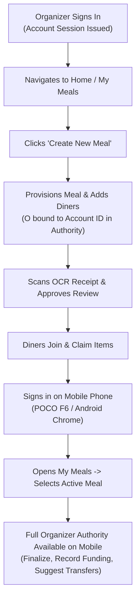
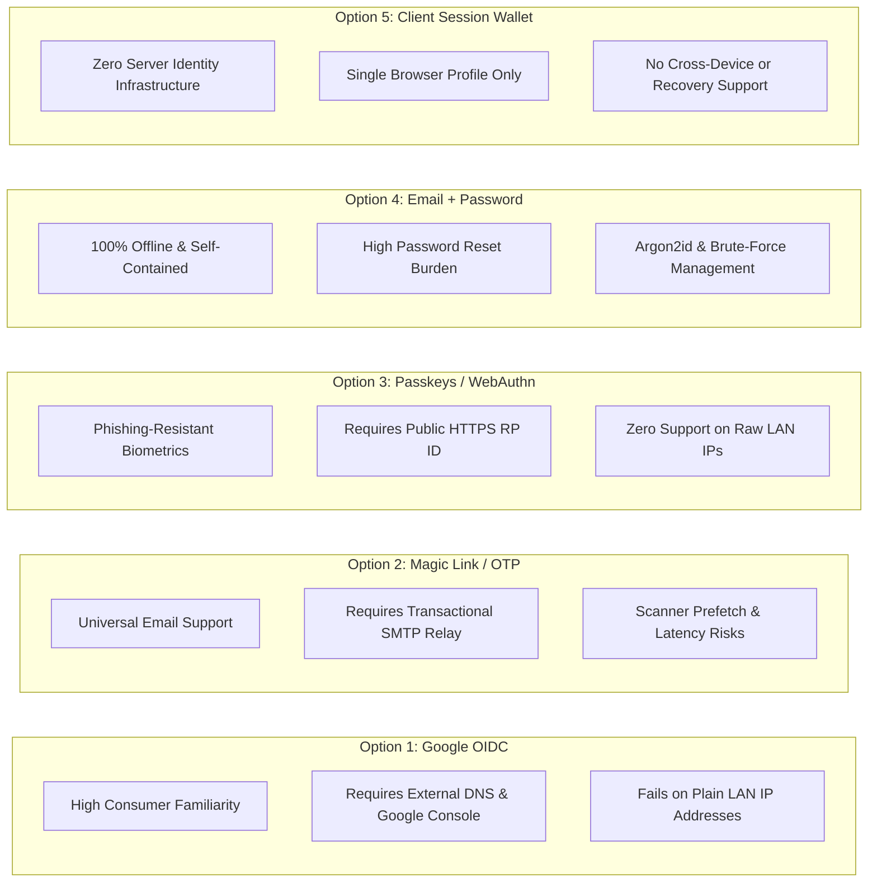
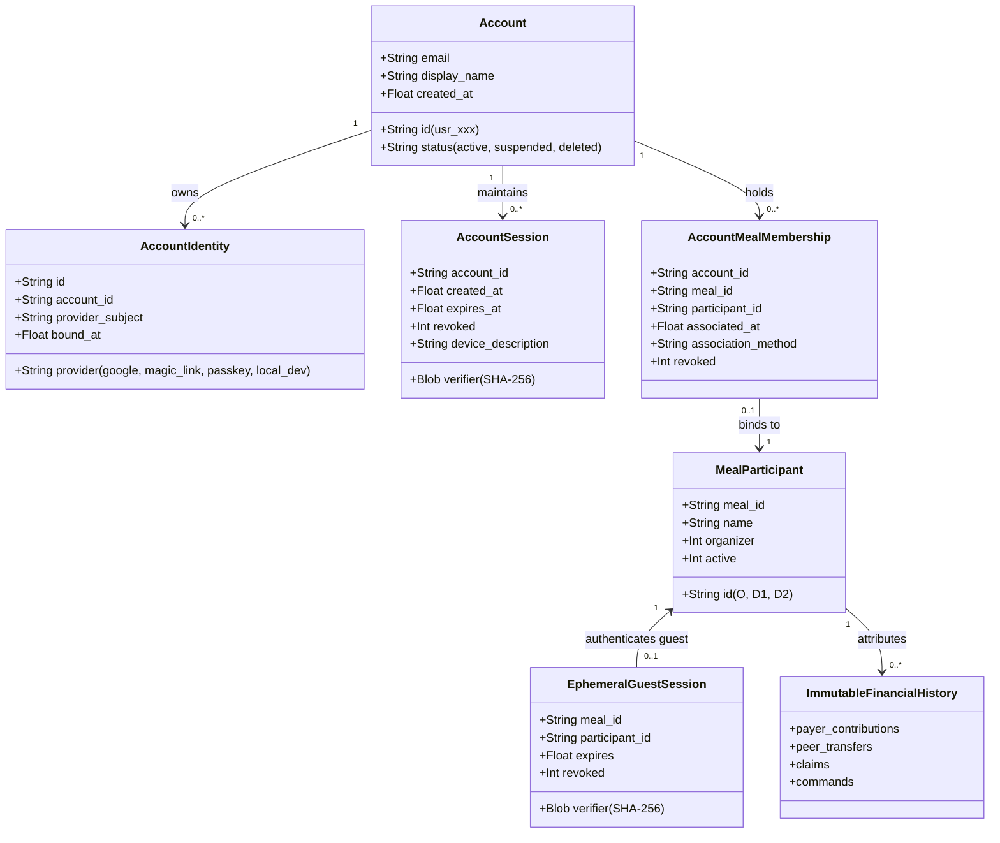
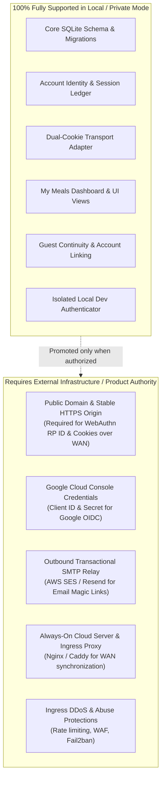

# SettleTable — Account Identity, Login & My Meals Roadmap

**Status:** PROPOSED — NOT APPROVED FOR IMPLEMENTATION  
**Author:** Antigravity / SettleTable Orchestrator  
**Date:** 2026-11-05 (Refined)  
**Target Milestone:** Post-PR #46 Architecture & Product Expansion  
**Domain:** Identity, Authentication, Multi-Meal Access & Persistence  
**Classification:** HIGH (Authentication, Authorization, Session Management, SQLite Schema Migrations)

---

## 1. Executive Summary

SettleTable has achieved complete functional stability and UX maturity across PR #1 through PR #46, verified by comprehensive unit test suites, browser CDP regression harnesses, desktop Google Chrome UAT, and physical Android Chrome UAT on a POCO F6.

Currently, all user participation in SettleTable is **meal-scoped and ephemeral**. Diners and organizers interact with meals via short-lived credentials stored in a single cookie (`settletable_session`), provisioned locally via loopback bootstrap, single-use invitation tokens, or organizer-approved join requests. While this model successfully protects meal isolation and satisfies zero-session dining requirements, it presents significant usability friction:
1. Users cannot maintain access to multiple meals simultaneously in the same browser profile.
2. Opening or joining a second meal clobbers the active session cookie of the first meal, causing `401 invalid_session` when returning.
3. If an organizer clears their cookies or tests diner links in the same browser, the meal becomes permanently orphaned with no recovery path.
4. Users have no centralized dashboard ("My Meals") to monitor active dinners, review past apportionments, or track outstanding reimbursements.
5. Cross-device access requires manually passing ephemeral bearer tokens or generating separate diner invites, and is impossible for organizers.

This document establishes a durable, evidence-based architectural roadmap for introducing **optional persistent user accounts and a "My Meals" dashboard** while strictly preserving SettleTable's existing core invariants:
- **First-class guest participation:** Diners can always join, claim items, and view splits without creating an account.
- **Financial immutability:** Apportionment math (`settletable.calculation`), integer sen representation, multi-payer contributions (`payer_contributions`), and peer settlements (`peer_transfers`) remain completely unchanged and bound to meal-specific `participant_id`s.
- **Single-database SQLite atomicity:** Identity, account sessions, and meal memberships reside within the same SQLite WAL database, ensuring zero-orphan atomic transactions during account linking and redemption.
- **Zero transport-only authorization bypass:** Meal-level authority checks are extended directly inside `Authority` transaction boundaries, cryptographically verifying account sessions and membership atomically before any state mutation or snapshot read.
- **Provider-agnostic identity core:** The system separates identity verification from session management, supporting OpenID Connect (e.g. Google), Email Magic Links, Passkeys, or local development providers through a unified adapter interface. The final production login provider choice remains an **OPEN DECISION** for the product owner.
- **Non-authorizing status:** This roadmap is an engineering and product plan. **No production code, schema migrations, or public deployments are authorized by this document.**

---

## 2. Problem Statement

### 2.1 The Single-Cookie Bottleneck
In the current transport layer (`settletable/transport.py`), the browser receives an `HttpOnly; Secure; SameSite=Strict; Path=/` cookie named `settletable_session`. Because `Path` is set to `/`, the browser attaches this single cookie to every HTTP request across the entire origin. 

When a user:
1. Organizes Meal A (cookie holds Meal A organizer credential).
2. Opens an invitation to Meal B (cookie is overwritten with Meal B diner credential).
3. Navigates back to Meal A (`/#/meal/meal-a`), the browser sends Meal B's credential to `/api/meals/meal-a/snapshot`.
4. `Authority._authenticate(verifier, 'meal-a')` fails because the verifier belongs to `meal-b`.
5. The frontend displays `Session Required: You are not authenticated for meal meal-a`, locking the user out.

### 2.2 Permanent Organizer Disconnection Risk
Unlike diners who can be re-invited by the organizer via `/api/meals/{meal_id}/invitations`, the meal organizer cannot be invited (`Authority.issue_invitation` explicitly asserts `not target.organizer`). Furthermore, organizers cannot join via general join links (`Authority.create_join_request` asserts `not is_organizer`). 

If an organizer's browser cookie expires (default TTL: 3600 seconds = 1 hour), is cleared by browser hygiene, or is overwritten in the same browser, **the meal is permanently orphaned**. No actor can finalize the meal, approve pending diners, review OCR receipts, or record settlement reimbursements.

### 2.3 Lack of Multi-Meal History & Cross-Device Portability
In real-world social dining, people participate in meals frequently (e.g., lunch with coworkers, dinner with friends). Currently, participants must retain raw URL invitation links or remember arbitrary meal IDs. There is no concept of a user profile that aggregates:
- Active meals awaiting allocation or review.
- Finalized meals with outstanding net balances owed or receivable.
- Historical receipts and Notion export summaries.

Moreover, if an organizer provisions a meal on a desktop laptop but wants to inspect or verify dining progress from their mobile phone at the restaurant table, there is no supported multi-device login mechanism.

---

## 3. Current Architecture — Verified Findings

All findings below are drawn directly from the verified `main` codebase at PR #46 merge head (`0c53edc3189941677fa58e1f9e6964d9ff043dde`).

### 3.1 Authentication & Session Issuance
- **[VERIFIED] Meal-Scoped Verifiers:** In `settletable/authority.py` lines 326–330, session credentials are 43-character URL-safe base64 strings generated via `secrets.token_urlsafe(32)` (providing 32 bytes / 256 bits of CSPRNG entropy). Persisted verifiers are domain-separated SHA-256 hashes:
  $$\text{verifier} = \text{SHA-256}(b\text{"settletable-local-session-v1\textbackslash 0"} + \text{credential.encode('ascii')})$$
- **[VERIFIED] Strict Table Foreign Keys:** The `sessions` table in SQLite is keyed by `verifier BLOB PRIMARY KEY` and enforces `UNIQUE(meal_id, participant_id)` with a composite foreign key referencing `participants(meal_id, id)`.
- **[VERIFIED] Authority Authentication Contract:** In `Authority._authenticate(verifier, meal_id)` (lines 861–867), authentication requires *both* the raw cryptographic verifier *and* the explicit target `meal_id`:
  ```sql
  SELECT p.id, p.organizer FROM sessions s
  JOIN participants p ON p.meal_id=s.meal_id AND p.id=s.participant_id
  WHERE s.verifier=? AND s.meal_id=? AND s.revoked=0 AND p.active=1 AND s.expires>?
  ```
- **[VERIFIED] Cookie Demarcation:** In `settletable/transport.py` lines 544, 593, 631, and 683, the transport adapter sets `Set-Cookie: settletable_session=<credential>; HttpOnly; Secure; SameSite=Strict; Path=/`. Raw credentials in JSON are strictly suppressed on cookie-authenticated requests to protect against XSS exfiltration.

### 3.2 Single-Session & Multi-Device Constraints
- **[VERIFIED] One Session per Participant per Meal:** In `Authority.redeem_invitation` (lines 1227–1230), redeeming an invitation executes:
  ```sql
  INSERT INTO sessions (verifier, meal_id, participant_id, expires, revoked)
  VALUES (?, ?, ?, ?, 0)
  ON CONFLICT(meal_id, participant_id) DO UPDATE SET verifier=?, expires=?, revoked=0
  ```
  Consequently, each participant within a meal can have at most **one** active session verifier. If a diner redeems an invitation on a second device, the first device's verifier is overwritten and immediately invalidated upon its next request (`401 invalid_session`).
- **[VERIFIED] Organizer Cannot Rotate Session:** In `Authority.rotate_session` (line 1272), rotation explicitly rejects organizers:
  ```python
  actor, organizer = self._authenticate(verifier, meal_id)
  _require(not organizer, 'forbidden')
  ```
  An organizer has no API mechanism to refresh, rotate, or re-issue their own session credentials.

### 3.3 Invitation & Join Request Lifecycle
- **[VERIFIED] Personal Invitations:** Created by an authorized organizer via `issue_invitation(organizer_credential, meal_id, participant_id)`. Mints a 43-character token verified by `settletable-invitation-v1\0`. Bounded to 64 lifetime generations per participant via `participant_lifecycle`. Single-use; marked `consumed = 1` atomically upon redemption.
- **[VERIFIED] General Join Requests:** Created unauthenticated via `POST /api/meals/{meal_id}/join-requests` with a candidate `display_name`. Matched strictly against active non-organizer participants. Verified by `settletable-join-claim-v1\0` with a 15-minute TTL. Requires organizer approval (`POST .../review_join_request`) followed by diner claim (`POST .../claim_join_request`).
- **[VERIFIED] Same-Browser Warning:** In `settletable/static/app.js` lines 1121–1130 and 1190–1199, the frontend explicitly warns users that accepting an invite or joining a meal in the same browser will clobber any existing organizer session.

### 3.4 Financial Linkage & Domain Isolation
- **[VERIFIED] Command Attribution:** In `settletable/authority.py`, all mutations (`ReplaceReceipt`, `SetOwnQuantity`, `AssignParticipantQuantity`, `RecordContribution`, `RecordTransfer`, etc.) are recorded in `commands` keyed by `(meal_id, participant_id, command_id)`.
- **[VERIFIED] Additive Ledgers:** `payer_contributions` and `peer_transfers` tables store immutable financial history. Both tables enforce database triggers (`prevent_payer_contributions_delete`, `prevent_payer_contributions_tamper`, `prevent_peer_transfers_delete`, `prevent_peer_transfers_tamper`) that strictly reject `DELETE` operations and forbid modifications to columns other than `status = 'reversed'` and `reversed_at/by/reason`.
- **[VERIFIED] Calculation Invariance:** `settletable.calculation` is completely pure, operating strictly on integer sen and rational fractions, returning `calc.Calculation(items, adjustments, consumption)`. The calculation engine has zero knowledge of transport, sessions, HTTP, or user identity.
- **[VERIFIED] Immutability of Finalized Meals:** Finalized calculations and receipt digests are sealed. Post-finalization mutations are strictly restricted to multi-payer funding and peer settlements.

### 3.5 Summary of Architecture Observations

| Architectural Dimension | Current Status | Classification |
|---|---|---|
| User Accounts | Non-existent; identities exist only as meal participants (`participants` table). | VERIFIED |
| Session Scope | Strictly meal-specific `(meal_id, participant_id)`. | VERIFIED |
| Concurrent Meals per Browser | Impossible; single `settletable_session` cookie at `Path=/` overwrites on switch. | VERIFIED |
| Multi-Device Access | Diners: serial only (Device B invalidates Device A). Organizers: zero support. | VERIFIED |
| Organizer Recovery | Zero recovery; session cookie loss permanently locks out organizer authority. | VERIFIED |
| Participant Linking | Financial records, claims, and ledgers reference meal-scoped `participant_id`. | VERIFIED |
| Financial Integrity | Deterministic integer sen, additive ledgers, SQLite triggers, pure calculator. | VERIFIED |
| Deployment Footprint | Loopback WSGI (`127.0.0.1:8000`), no external identity provider or mail server. | VERIFIED |

---

## 4. Product Goals and Non-Goals

### 4.1 Product Goals
1. **Optional Persistent Accounts:** Users can register an account once and retain their identity across sessions and devices.
2. **First-Class Guest Continuity:** Diners without accounts can still accept invitations, claim items, view apportionments, and participate with zero added friction.
3. **Multi-Meal Access in One Profile:** A user can be an organizer in Meal 1, a diner in Meal 2, and a past participant in Meal 3 simultaneously without session conflicts.
4. **"My Meals" Dashboard:** A responsive, accessible view listing active meals, pending reviews, finalized settlements, and personal balance summaries.
5. **Robust Organizer Recovery:** An organizer who creates a meal while signed in can access that meal from any device at any time; organizer authority is never permanently lost.
6. **Safe Guest-to-Account Linking:** A guest diner who participates in a meal can seamlessly and securely attach that meal's history to their registered account.
7. **Strict Financial Isolation:** The introduction of accounts must produce **zero modifications** to `settletable.calculation`, immutable ledgers, or existing deterministic test vectors.

### 4.2 Explicit Non-Goals
1. **Mandatory Account Creation:** SettleTable will never require diners to register or sign in simply to view a receipt or claim their portion.
2. **Real-Money In-App Payment Processing:** SettleTable records confirmed counter payments and peer reimbursements; it does not process live credit cards, bank API transfers, or hold escrow balances.
3. **Social Network / Friend Graph Features:** SettleTable is an apportionment tool, not a social network. No public profiles, friending, or activity feeds will be created.
4. **Cross-Meal Financial Aggregation:** Balances remain strictly settled per-meal. There is no automated cross-meal netting (e.g. offsetting a debt in Meal A against a credit in Meal B).
5. **Immediate Live Internet Deployment:** Planning accounts does not authorize exposing SettleTable to the public internet or incurring cloud hosting expenses.

---

## 5. Target User Experiences & User Journeys

### 5.1 Registered Organizer Journey



1. **Sign In:** Organizer opens SettleTable, authenticates via their preferred provider, and receives a persistent account session.
2. **Meal Creation:** From the My Meals dashboard, the organizer taps "Create Meal". The server provisions the meal and automatically binds the organizer participant (`'O'`) to their registered account in the same atomic bootstrap transaction.
3. **Seamless Dashboard Access:** The new meal appears under "Active Meals" in the organizer's My Meals dashboard with status badges (e.g., `Draft`, `Awaiting Allocation`, `Ready to Finalize`).
4. **Multi-Device Mobility:** The organizer can leave their laptop, open SettleTable on mobile Chrome at the restaurant, log in to their account, and immediately see the active meal with full organizer controls (reviewing OCR photos, approving join requests, recording multi-payer counter funding, and viewing peer settlement suggestions).
5. **Permanent Archival:** After finalization, the meal moves to "Past Meals". The organizer can re-open it at any time to review the sealed breakdown, inspect the receipt photo, or export to Notion without risking session loss.

### 5.2 Registered Diner Journey
1. **Receipt of Invitation:** Diner receives a private invitation link (`/invite/{token}`) or general join link (`/join/{mealId}`) via messaging.
2. **Context-Aware Landing:** When opening the link:
   - If already signed in: The landing page displays: *"Joining as Bob (Account: bob@example.com)"*. Tapping "Accept & Join" adds the meal to Bob's account and navigates directly to the meal room.
   - If not signed in: The landing page offers *"Accept as Guest"* or *"Sign in to save to My Meals"*.
3. **Persistent Association:** Once joined, the meal is bound to the diner's account.
4. **My Meals Re-Entry:** Next week, the diner navigates to `/#/my-meals`. The meal is visible under "Past Meals" showing their finalized portion (e.g. `Consumed: RM 34.50, Paid: RM 0.00, Owed to Alice: RM 34.50`). The diner does not need to search for the original invitation link.
5. **Simultaneous Participation:** The diner can participate in multiple active dining groups simultaneously without encountering session collision errors.

### 5.3 Guest Diner Journey (Preserved Baseline)
1. **Zero Registration:** Guest opens an invitation or general join link, enters their name (or verifies their pre-declared name), and joins with one click.
2. **Ephemeral Guest Session:** The browser receives an ephemeral guest meal cookie. The guest claims items, views real-time calculations, and sees suggested reimbursements.
3. **Clear Boundary Feedback:** A subtle header banner indicates: *"Browsing as Guest in this room. Your access is tied to this browser."*
4. **Optional Upgrade Path:** At any time (or on the finalized summary card), the guest can tap *"Save to Account"*. Upon completing authentication, their existing guest participant record is atomically bound to their account.

### 5.4 Session Lifecycle & Account Recovery
1. **Multi-Device Session Registry:** A user can see their active sessions (e.g., "Chrome on Windows — Active now", "Chrome on Android — Active 2h ago").
2. **Selective Logout:** Logging out of one device revokes only that device's account session token. The user can also choose "Log out of all devices".
3. **Session Revocation Graceful Degradation:** If an organizer revokes a participant's meal membership inside a meal (`RevokeMembership`), the diner's account session remains valid, but that specific meal is marked `revoked` in their My Meals dashboard and blocks further meal commands.
4. **Zero Cross-Contamination:** Joining a meal as a diner on a shared workstation never replaces or invalidates an existing organizer session for another meal.

---

## 6. Login Options & Authentication Alternatives

We evaluate five authentication architectures against SettleTable's private/local deployment profile, privacy requirements, and development ergonomics.



### 6.1 Evaluation Matrix

| Evaluation Criteria | 1. Google OIDC | 2. Email Magic Link / OTP | 3. Passkeys (WebAuthn) | 4. Email + Password (Argon2id) | 5. Client Session Wallet |
|---|---|---|---|---|---|
| **User Convenience** | High (1-tap on Android/Chrome) | Medium (switching to mail app) | Very High (biometric fingerprint/face) | Low (memorizing passwords) | High (instant, no login) |
| **Security & Phishing Resistance** | High (Google 2FA / infrastructure) | Medium (vulnerable to email compromise) | Maximum (origin-bound cryptographically) | Low/Medium (stuffing, weak passwords) | Low (unencrypted local browser storage) |
| **Account Recovery** | Handled by Google | Handled via email inbox | Synced via iCloud/Google or complex | Requires email reset flow | Impossible if storage cleared |
| **External Cloud Dependencies** | Google Identity API & OAuth Consent | Outbound SMTP Relay (SES, Resend) | None for auth; public domain for RP | Zero external dependencies | Zero external dependencies |
| **Localhost & Dev Support** | Supported on `localhost`; fails on LAN IPs | Supported via local dev endpoint | Supported on `localhost`; fails on LAN IPs | Excellent (runs 100% locally offline) | Excellent (pure client-side) |
| **Hosting & Domain Requirements** | Valid HTTPS or localhost; strict URIs | SMTP relay; SPF/DKIM/DMARC | Valid HTTPS; public FQDN (RP ID) | None (works on http://127.0.0.1) | None |
| **Maintenance Burden** | Google API / credential rotations | Email deliverability & spam filters | WebAuthn spec edge cases / fallback | Security patches, password resets | Minimal |
| **Implementation Complexity** | Medium (OIDC JWT verification) | Medium (token hashing, expiry, rate limits)| High (CBOR parsing, assertion crypto) | High (Argon2id, lockout, enumeration) | Very Low (LocalStorage/IndexedDB) |
| **Privacy Implications** | Discloses user auth to Google | Discloses user email to SettleTable | High privacy (pseudonymous public key) | High privacy (hashed credentials) | Maximum privacy (zero server knowledge)|

### 6.2 Deep Dive on Architectural Tradeoffs & Standards

#### 1. Google Sign-In / OpenID Connect (OIDC)
- **Standard:** OpenID Connect Core 1.0 (incorporating errata set 2, 2023); RFC 6749 (OAuth 2.0); RFC 7636 (PKCE).
- **Pros:** Extraordinary UX on Android (POCO F6) and Chrome; users do not need to create or remember credentials. Leverages Google's anti-abuse and multi-factor authentication.
- **Cons & Factual Specifics:** [VERIFIED] Google Identity Services (GIS) explicitly permits `http://localhost` and `http://localhost:<port>` for development. However, Google OAuth **strictly rejects raw local IP addresses** (e.g. `http://192.168.1.100:8000`), blocking cross-device testing over a local Wi-Fi network without dynamic DNS or an HTTPS tunnel. External dependency: cannot authenticate if internet access is interrupted.

#### 2. Email Magic Link or One-Time Password (OTP)
- **Standard:** OWASP Authentication Cheat Sheet (Passwordless section); IETF RFC 6238 (TOTP).
- **Pros:** Universal across all platforms and browsers; does not require third-party identity accounts; supports fully passwordless operation.
- **Cons & Constraints:** Production deployment requires an external transactional email provider (AWS SES, Resend, Postmark) configured with strict SPF, DKIM, and DMARC to prevent spam filtering. Email delivery introduces latency (30–90 seconds), degrading dining table UX. Corporate email scanners (link prefetching) can prematurely consume single-use links unless a secondary confirmation landing page is used. In local development, printing secrets to logs is prohibited (see Section 11.2).

#### 3. Passkeys / WebAuthn
- **Standard:** W3C Web Authentication Level 2 & Level 3; FIDO Alliance Passkey Implementation Guidelines.
- **Pros:** Peak cryptographic security; origin-bound public key pairs prevent phishing, credential stuffing, and server-side secret leaks; biometric instant sign-in on modern iOS and Android devices.
- **Cons & Factual Specifics:** [VERIFIED] Modern browsers treat `http://localhost` as a secure context for WebAuthn. However, the WebAuthn API **strictly refuses to run over unencrypted HTTP on raw LAN IP addresses** (e.g. `http://192.168.1.50:8000`). Without a public domain with valid TLS or an HTTPS tunnel, multi-device physical LAN testing is blocked. Account recovery without cloud-synced passkeys (i.e. if a hardware token is lost) requires a secondary fallback mechanism.

#### 4. Email and Password
- **Standard:** OWASP Authentication Cheat Sheet; NIST SP 800-63B; RFC 9106 (Argon2).
- **Pros:** 100% self-contained within Python standard library and SQLite; zero external dependencies; works seamlessly across localhost, LAN IPs, and private networks.
- **Cons & Constraints:** Worst user experience for casual dining app users. Requires complex backend defenses against brute-force attacks, timing attacks, credential stuffing, and user enumeration. Requires a password reset mechanism, which re-introduces the requirement for an email delivery system.

#### 5. Enhanced Client-Side "Session Wallet" (No Accounts)
- **Concept:** Keep the backend 100% unchanged. Upgrade the frontend (`app.js`) to store an encrypted index of joined meals and session credentials in the browser's `IndexedDB` or `localStorage`.
- **Pros:** Zero server changes; zero hosting requirements; zero privacy footprint; 100% offline.
- **Cons & Constraints:** Strictly restricted to a single browser profile. If the user clears browser cookies/storage, access is wiped out. Does not enable cross-device synchronization (e.g. creating on laptop and managing on phone). Does not satisfy the product requirement for durable cross-device identity.

### 6.3 Provisional Architecture Position
[INFERENCE] SettleTable will adopt a **Provider-Agnostic Core Architecture**:
1. **Core Account Engine:** Implement a provider-agnostic internal account and session store in SQLite (`accounts`, `account_identities`, `account_sessions`, `account_meal_memberships`).
2. **Pluggable Provider Interface:** Decouple authentication ingestion behind a clean Python interface (`AuthenticationProvider`).
3. **Local Development Authenticator:** Use a dedicated, strictly isolated loopback test authenticator (`LocalDevAuthProvider`) that returns tokens directly via HTTP response without printing secrets to logs.
4. **Production Provider Choice as Open Product Decision:** [OPEN DECISION] The selection of the primary production provider (Google OIDC vs. Email Magic Link vs. Passkeys) remains reserved for the Product Owner (see Section 15). The architecture is intentionally designed so that *any* provider can be connected without revising the underlying data model.

---

## 7. Recommended Architecture

The target architecture introduces a clean 5-tier separation of concerns, strictly preventing identity concepts from leaking into the financial core.



### 7.1 Database Schema Extensions (SQLite WAL)

All tables reside within SettleTable's existing SQLite database file. This ensures atomic foreign key checks and transactional consistency across meals, sessions, and memberships.

```sql
-- Tier 1: User Accounts
CREATE TABLE IF NOT EXISTS accounts (
    id TEXT PRIMARY KEY,                       -- e.g. 'usr_01j7bc9...' (CSPRNG or UUIDv7)
    email TEXT UNIQUE COLLATE NOCASE,          -- Normalized lowercase email
    email_verified_at REAL,                    -- Unix timestamp when verified, NULL if unverified
    display_name TEXT NOT NULL,                -- User's preferred default name (max 80 chars)
    created_at REAL NOT NULL,                  -- Unix timestamp
    status TEXT NOT NULL DEFAULT 'active' CHECK (status IN ('active', 'suspended', 'deleted'))
);

-- External Identity Bindings
CREATE TABLE IF NOT EXISTS account_identities (
    id TEXT PRIMARY KEY,
    account_id TEXT NOT NULL REFERENCES accounts(id) ON DELETE CASCADE,
    provider TEXT NOT NULL CHECK (provider IN ('google', 'magic_link', 'passkey', 'local_dev')),
    provider_subject TEXT NOT NULL,            -- e.g. Google sub, email string, or WebAuthn cred ID
    provider_email TEXT COLLATE NOCASE,
    created_at REAL NOT NULL,
    last_used_at REAL NOT NULL,
    UNIQUE(provider, provider_subject)
);
CREATE INDEX IF NOT EXISTS idx_account_identities_acc ON account_identities(account_id);

-- Tier 2: Account Authentication Sessions (Multi-Device)
CREATE TABLE IF NOT EXISTS account_sessions (
    verifier BLOB PRIMARY KEY,                 -- SHA-256(b'settletable-account-session-v1\0' + token)
    account_id TEXT NOT NULL REFERENCES accounts(id) ON DELETE CASCADE,
    created_at REAL NOT NULL,
    expires_at REAL NOT NULL,
    revoked INTEGER NOT NULL DEFAULT 0,
    last_active_at REAL NOT NULL,
    device_label TEXT,                         -- Sanitized user-agent summary (e.g. "Chrome / Windows")
    ip_prefix TEXT                             -- Privacy-preserving IP prefix (e.g. "192.168.1.0/24")
);
CREATE INDEX IF NOT EXISTS idx_account_sessions_acc ON account_sessions(account_id, revoked, expires_at);

-- Tier 3: Meal Membership Association
-- NOTE: Invariant: Role is NOT stored here. Role is derived dynamically from participants.organizer
-- to prevent dual-source-of-truth and stale-permission bugs.
CREATE TABLE IF NOT EXISTS account_meal_memberships (
    account_id TEXT NOT NULL REFERENCES accounts(id) ON DELETE CASCADE,
    meal_id TEXT NOT NULL REFERENCES meals(id) ON DELETE CASCADE,
    participant_id TEXT NOT NULL,
    associated_at REAL NOT NULL,
    association_method TEXT NOT NULL CHECK (association_method IN ('creator', 'invitation_redemption', 'join_request_claim', 'verified_link')),
    revoked INTEGER NOT NULL DEFAULT 0,
    PRIMARY KEY (account_id, meal_id),         -- Invariant: One account cannot hold multiple seats in one meal
    UNIQUE (meal_id, participant_id),          -- Invariant: One meal participant cannot belong to multiple accounts
    FOREIGN KEY (meal_id, participant_id) REFERENCES participants(meal_id, id) ON DELETE CASCADE
);
CREATE INDEX IF NOT EXISTS idx_account_meal_memberships_lookup ON account_meal_memberships(meal_id, participant_id);
```

### 7.2 Single Store vs. Separate Identity Service Evaluation
- **Option A: Separate Identity Database / Microservice:**  
  Store accounts and logins in an external auth service (Auth0, Supabase, separate auth.sqlite).
  *Drawbacks:* Creates distributed transaction failure modes. If a user redeems an invitation, associating their membership with the meal requires writing to both databases. A failure halfway through creates orphan tokens or un-redeemable invitations. Breaks SQLite foreign key enforcement. Rejected.
- **Option B: Unified SQLite Authority Database (Recommended):**  
  Keep accounts, sessions, and memberships in the existing SettleTable SQLite database file in WAL mode.
  *Advantages:* 100% transactional atomicity. Creating a meal, associating an account, consuming an invite, and recording membership occur within a single `BEGIN IMMEDIATE ... COMMIT` block. Zero distributed state desynchronization. Foreign keys guarantee that if a meal is pruned, all membership references cascade cleanly.

---

## 8. Session and Authorization Design

### 8.1 Dual-Cookie Strategy

To support both registered accounts and seamless guest dining, SettleTable will implement a dual-cookie model:

```
┌─────────────────────────────────────────────────────────────────────────────┐
│ COOKIE 1: Account Session Cookie                                            │
│ Name: settletable_account                                                   │
│ Content: 43-character base64url token (32 bytes / 256 bits CSPRNG entropy)  │
│ Attributes: HttpOnly; Secure; SameSite=Lax; Path=/                          │
│ Purpose: Identifies the logged-in user across all pages and My Meals        │
└─────────────────────────────────────────────────────────────────────────────┘
                                     │
                                     ▼
┌─────────────────────────────────────────────────────────────────────────────┐
│ COOKIE 2: Ephemeral Guest Meal Cookie                                       │
│ Name: settletable_session                                                   │
│ Content: 43-character base64url token (32 bytes / 256 bits CSPRNG entropy)  │
│ Attributes: HttpOnly; Secure; SameSite=Strict; Path=/                       │
│ Purpose: Retains fallback access for unauthenticated guest diners           │
└─────────────────────────────────────────────────────────────────────────────┘
```

### 8.2 Authority Seam Integration: Comparing Approaches & Provisional Design

A core architectural challenge is how account sessions authorize operations in `Authority` (`Authority.snapshot`, `Authority.apply`, etc.). In the current code, `Authority` methods take a 43-character meal credential and authenticate it via `Authority._authenticate(verifier, meal_id)`.

We compare three integration approaches:

| Dimension | Approach 1: Transport-Only Bridge | Approach 2: Ephemeral Meal-Token Bridge | Approach 3: Extended First-Class Authority Seam |
|---|---|---|---|
| **Mechanism** | Transport authenticates account, resolves `participant_id`, and calls new `Authority.apply_trusted(participant_id, ...)` | Transport dynamically mints a standard meal credential in `sessions` table upon account access | `Authority` accepts either a meal credential or an account session grant, authenticating inside `BEGIN IMMEDIATE` |
| **Security Seam** | **Weak:** Authority trusts transport assertions; creates an unauthenticated internal API surface | **Medium:** Uses standard session table, but pollutes session registry and generational limits | **Strong:** Zero transport-only bypass; Authority cryptographically verifies session and membership inside the atomic transaction |
| **Transaction Boundary** | **Split:** Account check and mutation occur in separate transactions (race hazard on revocation) | **Split/Complex:** Session minting and mutation require coordinating multiple writes | **Unified:** Single SQLite transaction authenticates account session, verifies membership, checks active participant, and applies mutation |
| **Generational Limit Impact** | None | High (rapidly exhausts 64-generation participant lifecycle limits) | None (account sessions track separate lifecycle) |
| **Evaluation** | **REJECTED (Security Hazard)** | **REJECTED (Operational Churn)** | **RECOMMENDED (Provisional Design)** |

#### Selected Provisional Design: Extended First-Class Authority Seam
`Authority` methods (`snapshot`, `apply`, etc.) are extended to accept a unified `AuthCredential` union:
`AuthCredential = MealCredential(token: str) | AccountCredential(token: str)`.

Inside `Authority._authenticate(auth_cred, meal_id)` within the **single atomic transaction** (`BEGIN` or `BEGIN IMMEDIATE`):
1. **If `MealCredential` (Guest / Legacy):**  
   Derives `verifier = SHA-256(b"settletable-local-session-v1\0" + token)`.  
   Executes existing lookup against `sessions` + `participants`.
2. **If `AccountCredential` (Registered User):**  
   Derives `account_verifier = SHA-256(b"settletable-account-session-v1\0" + token)`.  
   Executes an atomic join query:
   ```sql
   SELECT p.id, p.organizer, p.active, a.status
   FROM account_sessions s
   JOIN accounts a ON a.id = s.account_id
   JOIN account_meal_memberships m ON m.account_id = s.account_id AND m.meal_id = ? AND m.revoked = 0
   JOIN participants p ON p.meal_id = m.meal_id AND p.id = m.participant_id
   WHERE s.verifier = ? AND s.revoked = 0 AND s.expires_at > ?
   ```
   - Asserts `row is not None` (raises `AuthorityError('invalid_session')`).
   - Asserts `a.status == 'active'` (raises `AuthorityError('account_suspended')`).
   - Asserts `p.active == 1` (raises `AuthorityError('participant_inactive')`).
   - **Role Derivation Invariant:** The authoritative organizer role is derived **strictly from `p.organizer`**, guaranteeing zero risk of stale or out-of-sync roles.
   - Returns `(p.id, bool(p.organizer))`.

This design guarantees that:
- `Authority` never blindly trusts transport headers.
- If an account session is revoked or the participant is deactivated concurrently, the mutation is rejected atomically before commit.

### 8.3 Dual-Cookie Behavior & Deterministic Conflict Resolution Matrix

When a client presents both `settletable_account` and `settletable_session` cookies, the transport adapter resolves the request deterministically without silent actor switching:

| Scenario | Account Cookie State | Guest Cookie State | Deterministic Transport Resolution | Safety Rationale |
|---|---|---|---|---|
| **1. Agreeing Identity** | Valid for Meal A as Participant `D1` | Valid for Meal A as Participant `D1` | Authorize as `D1` via Account. Clear redundant guest cookie. | Both credentials resolve to the identical participant. |
| **2. Conflicting Meal Diners** | Valid for Meal A as Participant `D1` | Valid for Meal A as Participant `D2` | **REJECT WITH HTTP 409 (`conflicting_credentials`).** Mutation blocked. | **Strict Invariant:** Never silently switch actors. Silent switching during `SetOwnQuantity` or `RecordTransfer` could attribute commands to the wrong diner. |
| **3. Different Meals** | Valid for Meal A as Participant `D1` | Valid for Meal B as Participant `D3` | Request is for Meal A: Authorize as `D1` via Account. Ignore Meal B guest cookie. | No conflict on Meal A. Meal B cookie remains untouched for Meal B routes. |
| **4. Account Not a Member** | Valid account, but no membership in Meal A | Valid for Meal A as Participant `D1` | Authorize as Guest `D1`. Surface banner: *"Acting as Guest. [Save to Account]"*. | Allows logged-in users to visit new meals as guests without breaking their guest session. |
| **5. Expired Guest Cookie** | Valid for Meal A as Participant `D1` | Expired / invalid for Meal A | Authorize as `D1` via Account. Set-Cookie clears expired guest cookie. | Account provides valid fallback; guest cookie is dead. |
| **6. Expired Account Cookie** | Expired / revoked account | Valid for Meal A as Participant `D1` | Authorize as Guest `D1`. Surface notice: *"Account session expired. Browsing as Guest."* | Prevents account expiry from disrupting an active dining session. |
| **7. Neither Valid** | Missing / expired / revoked | Missing / expired / revoked | **REJECT WITH HTTP 401 (`invalid_session`).** | Unauthenticated request. |

### 8.4 Permissions Matrix

| Action / Capability | Registered Organizer | Registered Diner | Guest Diner |
|---|---|---|---|
| View My Meals Dashboard | ✅ Full (Active + Past) | ✅ Full (Active + Past) | ❌ Restricted to current room |
| Create New Meal | ✅ Bound to Account | ✅ Bound to Account | ✅ Local loopback only |
| Scan & Edit OCR Receipts | ✅ Authorized | ❌ 403 Forbidden | ❌ 403 Forbidden |
| Review & Seal Receipt | ✅ Authorized | ❌ 403 Forbidden | ❌ 403 Forbidden |
| Claim / Split Own Portion | ✅ Authorized | ✅ Authorized | ✅ Authorized |
| Assign Other Diners' Items | ✅ Authorized | ❌ 403 Forbidden | ❌ 403 Forbidden |
| Seal & Finalize Meal | ✅ Authorized | ❌ 403 Forbidden | ❌ 403 Forbidden |
| Record Counter Funding | ✅ Authorized | ❌ 403 Forbidden | ❌ 403 Forbidden |
| Record Peer Settlement | ✅ Authorized | ❌ 403 Forbidden | ❌ 403 Forbidden |
| Access from Multiple Devices | ✅ Simultaneous | ✅ Simultaneous | ❌ Single device only |
| Recover Lost Session | ✅ Via Account Login | ✅ Via Account Login | ❌ Requires new invite |

---

## 9. Legacy Meal Migration and Account Linking

### 9.1 The Identity Linking Security Principle
> **Fundamental Security Invariant:** Matching names or claimed email addresses must NEVER be accepted as sufficient proof of account ownership or meal participation.

An attacker must never be able to claim Alice's diner record simply by registering an account with the name "Alice". Account association requires **cryptographic proof of capability possession**.

### 9.2 Permitted Association Vectors

```mermaid
sequenceDiagram
    autonumber
    actor User as Registered User (Logged In)
    participant Client as Browser (SettleTable SPA)
    participant Trans as Transport Adapter
    participant Auth as Authority (SQLite WAL)

    Note over User,Auth: Scenario: Guest Diner links active meal to Account
    Client->>Trans: POST /api/meals/{meal_id}/associate-account<br/>(settletable_account + active guest settletable_session)
    Trans->>Auth: bind_meal_membership(account_id, meal_id, guest_credential)
    Auth->>Auth: 1. Validate account_id is active<br/>2. Authenticate guest_credential inside SQLite -> (participant_id, is_organizer)<br/>3. Verify (meal_id, participant_id) not already in account_meal_memberships<br/>4. INSERT INTO account_meal_memberships(account_id, meal_id, participant_id)<br/>5. Revoke or mark guest session upgraded
    Auth-->>Trans: Association Confirmed (participant_id, is_organizer)
    Trans-->>Client: 200 OK + Set-Cookie: settletable_session=; Max-Age=0
    Note over Client: Meal now permanently visible in My Meals!
```

Association is authorized **strictly** through four mutually exclusive, verifiable vectors:

1. **Direct Provisioning (Creator):**
   - The user is already logged into an account when calling `bootstrap` / `create_meal`.
   - The newly created organizer participant (`'O'`) is bound to `account_id` in the same bootstrap transaction.
2. **Invitation Token Redemption:**
   - The user opens `/invite/{token}` while logged into an account.
   - The authority validates the single-use token against `invitations` (`consumed == 0`, `revoked == 0`, `expires > now`).
   - In a single SQLite transaction:
     - Mark invitation `consumed = 1`.
     - Record `account_meal_memberships` for the invited `participant_id`.
3. **Approved Join Request Claim:**
   - The user submits a general join request while logged into an account.
   - Upon organizer approval, the client claims the approved request presenting `claim_token`.
   - In a single SQLite transaction:
     - Mark join request `claimed`.
     - Record `account_meal_memberships` for the claimed `participant_id`.
4. **Authenticated Active Guest Upgrade:**
   - A user who has an active, unexpired `settletable_session` cookie for Meal A logs in or signs up.
   - The client calls `POST /api/meals/meal-a/associate-account` presenting both cookies.
   - The server verifies that the caller currently possesses the valid, unexpired, unrevoked session credential for `(meal-a, participant_id)`.
   - The server verifies that `(meal-a, participant_id)` is not already bound to another account.
   - The membership is recorded atomically, and the guest cookie is cleared (`Max-Age=0`).

### 9.3 Migration of Pre-Existing (Legacy) Meals & Organizer Recovery

Historical meals bootstrapped under PR #1 through PR #46 will have rows in `meals`, `participants`, `sessions`, `payer_contributions`, etc., but zero rows in `account_meal_memberships`.

We distinguish three explicit recovery states:

1. **Active Credential-Based Linking:**  
   If the organizer still holds an active, unexpired session in their browser, they can link the meal using the standard `POST /api/meals/{meal_id}/associate-account` flow while logged into their registered account.
2. **Expired or Missing Credentials:**  
   If the organizer session has expired or the browser cookie was deleted, **the credential is irretrievably expired**. In accordance with SettleTable's cryptographic invariants, `Authority` strictly rejects expired credentials.
3. **Host-Level Administrative Recovery (Offline Only):**  
   [IMPORTANT] **No unauthenticated or secret-guessing HTTP endpoint will be introduced.**  
   If an organizer has lost their session for a legacy meal, recovery cannot occur over HTTP. Instead, an offline administrative CLI command is provided for the database owner on the host server:
   ```bash
   python -m settletable.admin link-organizer --db /path/to/settletable.sqlite --meal <meal_id> --account <account_id>
   ```
   This tool requires direct file-system access to the SQLite database and administrative host privileges, ensuring zero exposure to remote web exploitation.

---

## 10. Security Threat Model

| Threat Scenario | Attack Vector | SettleTable Architectural Mitigation |
|---|---|---|
| **Account Takeover via Brute Force** | Rapidly attempting magic link tokens or guessing session identifiers. | 43-character base64url tokens provide 32 bytes (256 bits) of cryptographic entropy. Server enforces strict IP/account rate limits and 15-minute token expiry. |
| **Unauthorized Meal Discovery** | Enumerating meal IDs to view sensitive diner receipts. | Meal IDs are non-sequential strings. `GET /api/meals/{mealId}/snapshot` strictly enforces 401/403 for non-members. Anti-enumeration: invalid targets return generic `invalid_join_target`. |
| **Cross-Meal Authorization Leakage** | Using a valid session from Meal A to mutate or read Meal B. | Every query in `Authority` joins strictly on `WHERE meal_id=?`. Account memberships are composite-keyed `(account_id, meal_id)`. Zero global access. |
| **Invitation Token Replay** | Re-using an intercepted invitation link to gain unauthorized meal access. | Single-use consumption in SQLite `BEGIN IMMEDIATE` transaction. Token verifier is marked `consumed = 1` atomically before session grant. Replay fails with `invalid_invitation`. |
| **Session Fixation / Hijacking** | Forcing a predefined session token on a victim or intercepting plaintext cookie. | `settletable_account` and `settletable_session` cookies are strictly `HttpOnly; Secure; SameSite=Lax/Strict`. Fresh tokens minted upon login; old tokens revoked. |
| **Conflicting Dual-Cookie Ambiguity** | Sending account cookie for Diner A and guest cookie for Diner B in same meal. | Strict rejection with `409 conflicting_credentials`. Server refuses to guess or silently switch actor identity. |
| **Deactivated Participant Access Attempt** | Using a valid account session after organizer revoked the diner's seat. | `Authority._authenticate` atomically checks `participants.active == 1`. Revoked participants reject with `403 participant_inactive` regardless of account session validity. |
| **Concurrent Device Desynchronization** | Multiple devices submitting conflicting item quantities simultaneously. | Optimistic concurrency via `expected_revision`, `expected_financial_revision`, and `expected_item_revision`. Conflicting mutations reject with `item_revision_conflict` (409) and prompt snapshot refresh. |
| **Logout Bypass & Stale Sessions** | Using a copied session cookie after logging out. | Server-side revocation ledger in `account_sessions`. Logging out updates `revoked = 1`. Next request rejects immediately regardless of cookie presence. |
| **Cross-Site Request Forgery (CSRF)** | Malicious third-party website triggering state mutations via stored cookies. | Two-layer defense: 1) Mandatory custom header `X-SettleTable-Action: 1` required on all `POST/DELETE` routes. 2) Server-side Origin/Referer header verification against configured `server_origin`. |
| **Malicious Account Linking** | Claiming someone else's diner seat in a meal by guessing their name. | Linking strictly requires physical possession of a single-use invite token, approved join claim token, or active unrevoked session verifier. Matching names alone reject. |
| **Organizer Privilege Escalation** | A diner attempting to bind to participant `'O'` during account linking. | `Authority.issue_invitation` and `create_join_request` forbid organizer targets. Account linking verifies `participant.organizer == 0` unless authorized via bootstrap creator flow. |
| **Legacy Organizer Recovery Spoofing** | Remote attacker attempting to hijack an orphaned meal over HTTP. | No HTTP recovery endpoint exists for expired credentials. Organizer recovery is strictly offline via the host-level CLI tool requiring direct SQLite file access. |
| **IdP Token Substitution Attack** | Submitting an ID token issued for a different app to SettleTable's login endpoint. | Server validates OIDC `aud` claim matches SettleTable's exact Client ID, and `iss` matches `https://accounts.google.com`. |

---

## 11. Hosting and External Dependency Considerations

> **CRITICAL ARCHITECTURAL POLICY:** SettleTable's hosting and deployment strategy is an **OPEN PRODUCT DECISION**. Public internet deployment is NOT authorized by this roadmap.

### 11.1 Local/Private Capability vs. External Production Prerequisites



### 11.2 Isolated Local Development Authenticator

To enable robust development and automated testing without external dependencies, and **strictly preventing the logging of sensitive tokens**:

1. **Explicit Environment Guard:** The dev authenticator is active ONLY when `SETTLETABLE_DEV_AUTH=1` is set in the environment. In production, this flag is omitted, causing dev auth endpoints to return `404 Not Found`.
2. **Loopback-Only Ingress Boundary:** The dev endpoint strictly validates:
   - `environ['REMOTE_ADDR'] in ('127.0.0.1', '::1', 'localhost', 'testclient')`.
   - Absence of all proxy headers (`X-Forwarded-For`, `Forwarded`, `X-Real-IP`, etc.), matching the loopback security boundary on `POST .../bootstrap`.
3. **Dedicated Loopback Endpoint:** `POST /api/auth/dev/login` accepting `{"email": "alice@example.com", "display_name": "Alice"}`.
4. **Zero-Secret Logging Policy:**  
   The minted session token is returned **strictly via the `Set-Cookie: settletable_account=...` header and HTTP response payload to the local caller**.  
   **NO token, secret, or magic link URL is printed to stdout, stderr, or application log files.** Log sanitization (`redact_log_string`) remains active and enforced.

---

## 12. Phased Implementation Roadmap

```mermaid
gantt
    title SettleTable Identity & My Meals Implementation Sequence
    dateFormat  X
    axisFormat %s
    section Phase 0: Governance
    Architecture & Threat Alignment    :p0, 0, 1
    section Phase 1: Foundation
    SQLite Schema & Account Authority  :p1, 1, 2
    section Phase 2: Ingestion & Linking
    Dual Cookies & Dev Authenticator   :p2, 2, 3
    section Phase 3: My Meals UI
    Dashboard & Navigation Polish      :p3, 3, 4
    section Phase 4: Hardening
    Admin Tools, Migration & UAT       :p4, 4, 5
```



### Phase 0 — Architecture, Security and Product Decisions
- **Objectives:** Align on data contracts, governance gates, and provider boundaries before authoring code.
- **Functional Requirements:** Finalize `SPEC.md` for account identity; specify exact JSON request/response formats.
- **Components Likely Affected:** Documentation, `docs/agents/phase-transitions.md`.
- **Data Model Implications:** None (specification only).
- **Dependencies:** This roadmap approval.
- **Security Risks:** Premature implementation before threat model sign-off.
- **Required Tests:** None.
- **Acceptance Criteria:** Orchestrator records implementation readiness; `SPEC.md` written and independently reviewed.
- **Explicit Non-Goals:** Writing application code.
- **Completion Gate:** Orchestrator approval in `PROJECT_STATUS.md`.

### Phase 1 — Persistent Identity & Session Foundation
- **Objectives:** Establish the database schema and core Python authority methods for user accounts and account sessions.
- **Functional Requirements:**
  - Create `accounts`, `account_identities`, `account_sessions`, and `account_meal_memberships` in SQLite.
  - Implement `Authority.create_account()`, `Authority.authenticate_account_session()`, `Authority.revoke_account_session()`.
  - Extend `Authority._authenticate` to support `AccountCredential` with atomic role derivation from `participants.organizer`.
  - Implement atomic account-to-participant membership binding (`Authority.bind_meal_membership()`).
- **Components Likely Affected:** `settletable/authority.py`, new module `settletable/identity.py`.
- **Data Model Implications:** Additive SQLite tables with foreign keys and WAL triggers.
- **Dependencies:** Phase 0 completion.
- **Security Risks:** Session verifier leakage; SQL injection; unhandled concurrency during session insertion.
- **Required Tests:**
  - Unit tests verifying domain-separated verifiers (`settletable-account-session-v1\0`).
  - Concurrency tests verifying multi-device session insertion and single-device revocation.
  - Assertions proving revoked participants (`active == 0`) are rejected despite valid account sessions.
- **Acceptance Criteria:** 100% unit test coverage for account authority; zero changes to `settletable/calculation.py`.
- **Explicit Non-Goals:** Modifying the browser UI or frontend code.
- **Completion Gate:** Independent code and security review PASS; Python test suite 100% green.

### Phase 2 — Login Ingestion, Dual Cookies & Guest Compatibility
- **Objectives:** Connect the transport layer to identity ingestion; establish dual-cookie resolution and guest account linking.
- **Functional Requirements:**
  - Implement dual-cookie resolution in `settletable/transport.py` with deterministic conflict rejection (`409 conflicting_credentials`).
  - Implement `LocalDevAuthProvider` gated by `SETTLETABLE_DEV_AUTH=1` and loopback checks.
  - Add `POST /api/meals/{meal_id}/associate-account` for guest-to-account upgrades with clean cookie transition.
  - Update `POST /api/meals/{meal_id}/bootstrap` to optionally bind `'O'` to the authenticated account.
- **Components Likely Affected:** `settletable/transport.py`, `settletable/identity.py`.
- **Data Model Implications:** Insertion into `account_meal_memberships` during invite redemption and bootstrap.
- **Dependencies:** Phase 1 completion.
- **Security Risks:** CSRF on login endpoints; open redirect vulnerabilities; session fixation on login.
- **Required Tests:**
  - Transport tests for `settletable_account` cookie attributes (`HttpOnly; Secure; SameSite=Lax`).
  - Dual-cookie conflict tests asserting 409 rejection on mismatched participants.
  - Guest linking tests proving unauthenticated attackers cannot link arbitrary participant IDs.
- **Acceptance Criteria:** Dual-cookie resolution verified; guest dining continues to work 100% unbroken.
- **Explicit Non-Goals:** External Google Cloud Console setup (mocked via provider interface).
- **Completion Gate:** Transport regression suite PASS; independent spec review PASS.

### Phase 3 — My Meals Dashboard & Membership Discovery
- **Objectives:** Deliver the user-facing "My Meals" dashboard and navigation in the single-page application.
- **Functional Requirements:**
  - Implement `GET /api/my-meals` returning active and past meals associated with the account.
  - In `settletable/static/app.js`, add `#/my-meals` route and navigation bar user status pill.
  - Implement responsive cards for Active Meals (with status: OCR Pending, Allocation, Finalized) and Past Meals.
  - Display personal consumption vs contribution summary per meal.
  - Provide a one-click "Switch Meal" navigation that does not clobber account state.
- **Components Likely Affected:** `settletable/static/app.js`, `settletable/static/style.css`, `settletable/transport.py`.
- **Data Model Implications:** Read-only queries against `account_meal_memberships` and `meals.state`.
- **Dependencies:** Phase 2 completion.
- **Security Risks:** Authorization bypass in `GET /api/my-meals` disclosing meals belonging to other accounts.
- **Required Tests:**
  - Headless Chrome CDP tests (`tools/verify_my_meals_flow.mjs`) testing login -> meal creation -> My Meals dashboard -> second meal join -> seamless switching.
  - Mobile touch-target ($\ge 44\text{px}$) and zero horizontal clipping checks across 320px–430px viewports.
- **Acceptance Criteria:** Users can switch back and forth between multiple meals without re-authenticating or encountering 401 errors.
- **Explicit Non-Goals:** Social sharing or global search.
- **Completion Gate:** Browser CDP test suite PASS on mobile viewports; independent UI audit PASS.

### Phase 4 — Admin Recovery, Hardening & UAT
- **Objectives:** Implement offline host-level administrative recovery CLI, multi-device management views, and execute end-to-end UAT.
- **Functional Requirements:**
  - Implement `python -m settletable.admin link-organizer` CLI tool for host-level legacy meal recovery.
  - Add active session list in My Meals with "Log out of other devices" button.
  - Add comprehensive audit logging for account security events.
- **Components Likely Affected:** `settletable/admin.py`, `settletable/authority.py`, `settletable/transport.py`, `settletable/static/app.js`.
- **Data Model Implications:** Additive trigger or audit rows.
- **Dependencies:** Phase 3 completion.
- **Security Risks:** Privilege escalation via administrative tools (mitigated by direct file-system requirement).
- **Required Tests:**
  - Failure-injection tests during account linking.
  - Session revocation tests across simulated concurrent browser profiles.
  - Full application regression suite (Python unit, CDP browser, OCR, Notion, multi-payer funding, peer settlement).
- **Acceptance Criteria:** Zero regression across PR #1 through PR #46 feature baseline; formal computer-use UAT executed and passed.
- **Explicit Non-Goals:** Paid third-party penetration testing.
- **Completion Gate:** Orchestrator records final acceptance in `PROJECT_STATUS.md`.

---

## 13. Acceptance Criteria and Testing Strategy

### 13.1 Automated Verification Strategy
Following SettleTable's proven test-driven methodology, all phases will implement layered testing:

1. **Python Unit & Concurrency Tests (`tests/test_account_*.py`):**
   - Cryptographic verifier domain separation assertions.
   - Concurrency tests using `threading.Barrier` racing simultaneous logins, redemptions, and revocations.
   - Assertions verifying that `Authority._authenticate` derives organizer role dynamically from `participants.organizer`.
   - Assertions verifying that deactivated participants (`active == 0`) reject immediately with `participant_inactive`.
   - Rollback assertions proving that database failures during account linking leave zero orphan records.
2. **Transport Boundary Tests (`tests/test_transport_account.py`):**
   - Boundary tests verifying header limits, strict JSON parsing, and rejection of duplicate keys.
   - CSRF defense verification ensuring `POST /api/auth/*` and `POST /api/meals/*/associate-account` reject missing `X-SettleTable-Action: 1` or mismatched Origin.
   - Dual-cookie conflict tests asserting HTTP 409 when account and guest cookies specify conflicting diners for the same meal.
   - Cookie hygiene assertions verifying `settletable_account` is omitted from JSON responses.
3. **Headless Chrome CDP E2E Harness (`tools/verify_account_and_my_meals_flow.mjs`):**
   - Real multi-context browser testing simulating:
     - User Alice creates Meal 1 on Context A (Organizer).
     - User Bob signs in on Context B, receives invite to Meal 1, joins, and verifies Meal 1 in Bob's My Meals.
     - User Bob creates Meal 2 on Context B (Organizer).
     - User Bob navigates between Meal 1 (as Diner) and Meal 2 (as Organizer) with ZERO session loss.
     - Visual viewport regression tests asserting 44px touch targets and zero horizontal clipping across 320px, 375px, 390px (POCO F6), and 430px viewports.

---

## 14. Risks and Alternatives

| Identified Risk | Severity | Mitigation Strategy |
|---|---|---|
| **Accidental Invalidation of Guest Diners** | HIGH | Strict preservation of `settletable_session` cookie resolution and anonymous join routes. CI test suite includes dedicated guest-only regression passes. |
| **Silent Actor Switching in Dual-Cookie Requests** | HIGH | Strict enforcement of Scenario 2 conflict matrix: return `409 conflicting_credentials` if cookies resolve to different participants in the same meal. |
| **Dual-Source-of-Truth Role Corruption** | HIGH | Omit `role` from `account_meal_memberships`. Derive effective organizer permissions dynamically from `participants.organizer` inside `Authority._authenticate`. |
| **Leakage of Dev Login Secrets into Logs** | MEDIUM | `LocalDevAuthProvider` returns session tokens strictly via HTTP response to loopback; zero logging to stdout/stderr. |
| **Database Lock Contention on SQLite WAL** | MEDIUM | Transactions in SQLite WAL mode are kept ultra-short (< 5ms). Account queries do not hold exclusive transaction locks during password hashing or token verification. |
| **Memory / Storage Bloat from Stale Sessions** | LOW | Scheduled cleanup of expired `account_sessions` rows during ordinary bootstrap and periodic vacuuming. |

---

## 15. Open Product Decisions (Reserved for Product Owner)

The following choices are explicitly preserved for product owner authority under `docs/agents/governance.md`:

1. **Primary Production Authentication Provider Selection:**
   - *Option A:* Google Sign-In as default (optimized for mobile Android/Chrome diner convenience).
   - *Option B:* Email Magic Link / OTP as default (optimized for universal access without Google dependence).
   - *Option C:* Passkeys / WebAuthn as default (optimized for phishing resistance and biometrics).
   - *Option D:* Hybrid (allow user to sign in with either Google or Email).
2. **Account Retention & Inactivity Policy:**
   - Duration before inactive accounts or unclaimed meals are pruned (e.g. 90 days vs indefinite retention).
3. **External Hosting and Production Cutover:**
   - Timing and budget for purchasing a custom domain, configuring cloud TLS termination, and deploying beyond local loopback.

---

## 16. Future Implementation Handover Checklist

When an agent or developer is authorized to implement Phase 1, they must complete the following pre-flight verification:

- [ ] Confirm `PROJECT_STATUS.md` records official authorization for Phase 1.
- [ ] Verify that current `main` passes all 294+ Python tests (`python -m unittest discover tests`).
- [ ] Verify that CDP browser suites pass (`node tools/e2e_browser_test.mjs`, `node tools/verify_mobile_ux_remediation.mjs`).
- [ ] Create a dedicated feature branch `feature/account-identity-foundation`.
- [ ] Ensure `settletable/calculation.py` remains completely byte-untouched throughout the implementation.
- [ ] Implement additive SQLite migrations in `settletable/authority.py` using `CREATE TABLE IF NOT EXISTS` with strict foreign keys.
- [ ] Implement `Authority._authenticate` extension with dynamic role derivation from `participants.organizer`.
- [ ] Add dedicated unit tests in `tests/test_account_identity.py` and `tests/test_account_adversarial.py`.
- [ ] Follow autonomous PR review workflow: delegate independent Standards and Spec reviews before merging.

---

## 17. References

All external documentation consulted and verified for this roadmap (accessed 2026-11-05):

1. **OWASP Session Management Cheat Sheet:**  
   [https://cheatsheetseries.owasp.org/cheatsheets/Session_Management_Cheat_Sheet.html](https://cheatsheetseries.owasp.org/cheatsheets/Session_Management_Cheat_Sheet.html)  
   *Verified Guidelines:* Explicit expiry, domain-separated cookie scoping, `HttpOnly`, `Secure`, and `SameSite` defense-in-depth.
2. **OWASP Cross-Site Request Forgery Prevention Cheat Sheet:**  
   [https://cheatsheetseries.owasp.org/cheatsheets/Cross-Site_Request_Forgery_Prevention_Cheat_Sheet.html](https://cheatsheetseries.owasp.org/cheatsheets/Cross-Site_Request_Forgery_Prevention_Cheat_Sheet.html)  
   *Verified Guidelines:* Custom request header verification (`X-SettleTable-Action`), origin matching, and same-site cookies.
3. **OWASP Authentication Cheat Sheet:**  
   [https://cheatsheetseries.owasp.org/cheatsheets/Authentication_Cheat_Sheet.html](https://cheatsheetseries.owasp.org/cheatsheets/Authentication_Cheat_Sheet.html)  
   *Verified Guidelines:* Passwordless magic link single-use constraints, rate limiting, and user enumeration defenses.
4. **OpenID Connect Core 1.0 (incorporating errata set 2, 2023):**  
   [https://openid.net/specs/openid-connect-core-1_0.html](https://openid.net/specs/openid-connect-core-1_0.html)  
   *Verified Specifications:* Authorization Code Flow with PKCE, JWT signature validation, `iss` and `aud` verification.
5. **W3C Web Authentication (WebAuthn Level 3):**  
   [https://www.w3.org/TR/webauthn-3/](https://www.w3.org/TR/webauthn-3/)  
   *Verified Specifications:* Relying Party ID binding, secure context requirements on localhost vs WAN, client data JSON challenges.
6. **CPython sqlite3 Reference Manual:**  
   [https://docs.python.org/3/library/sqlite3.html](https://docs.python.org/3/library/sqlite3.html)  
   *Verified Guidelines:* Explicit transaction management with `isolation_level=None`, WAL mode concurrency, and table trigger semantics.
7. **SettleTable Repository Specifications:**
   - `docs/authority-interface.md`: Local draft authority contract and command specifications.
   - `docs/deployment-boundary.md`: Two-tier security boundary and ingress proxy guidelines.
   - `research/phase-3/transport-identity-challenge.md`: Independent identity, session, and invitation challenge.
