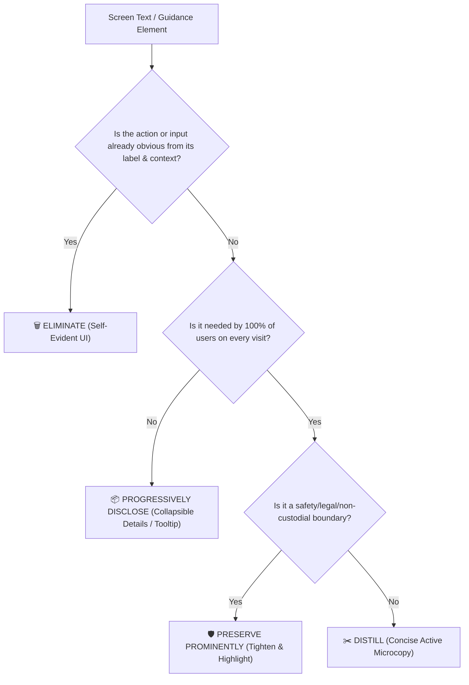

# SettleTable — UX Writing, Content Density & Cognitive Load Audit

## 1. Executive Summary & Research Foundation

During recent testing, an important UX challenge was identified:
> *"There is so much text on the screen, making the UI look complicated and overwhelming users... each action should be obviously understandable by the user immediately after looking at the UI instead of reading guidance to understand each action required."*

### Is This Backed by Research?
**Yes, unequivocally.** Decades of human-computer interaction (HCI) and usability research confirm that excessive instructional text degrades usability rather than enhancing it:

1. **Steve Krug's Laws of Usability (*Don't Make Me Think*):**
   - **First Law**: A web interface should be self-evident. If an action requires an explanatory paragraph to explain why or how to tap it, the affordance or visual hierarchy is failing.
   - **Third Law ("Get rid of words")**: *"Get rid of half the words on each page, then get rid of half of what’s left."* Users do not read web pages like books; they scan for clickable elements, numbers, and status indicators.
2. **Nielsen Norman Group (NN/g) Research on Scanning & Cognitive Load:**
   - **79% of users scan**: Eye-tracking studies demonstrate that users glance at headings, bold labels, buttons, and numbers in an F-shaped pattern. Blocks of explanatory body text are routinely skipped.
   - **Cognitive Working Memory (Sweller / Miller / Cowan)**: Working memory is limited to roughly 4 active chunks. Presenting explanatory sentences beneath every card, field, and button taxes mental bandwidth, causing hesitation and perceived complexity.
   - **Banner Blindness & Noise Fatigue**: When every card contains informational callouts, genuinely critical notices (such as security warnings or financial boundaries) lose visual prominence.
3. **Progressive Disclosure Principle (Jakob Nielsen):**
   - Provide only the information necessary to complete the primary task on the main screen.
   - Secondary explanations, edge cases, and background mechanics belong in contextual progressive disclosure (collapsible `
`, `ℹ️` tooltips, or popover modals) where they can be accessed on demand without cluttering the viewport.
4. **Fintech Design Standards (Splitwise, Wise, Stripe, Cash App):**
   - High-trust financial tools feel lightweight, clean, and confident.
   - Trust is built through deterministic numbers, crisp status pills (`Fully Paid`, `Owes RM 15.00`), and explicit confirmation dialogues on consequential actions—not lengthy defensive prose.

---

## 2. Text Categorization Framework

To systematically evaluate every piece of copy in SettleTable, we classify text into four clear buckets:

1. **🗑️ Eliminate (Self-Evident UI)**: Helper text beneath buttons or inputs that simply repeats what the label or control already clearly communicates.
2. **✂️ Distill (Concise Microcopy)**: Essential guidance that is currently written as multi-sentence paragraphs, condensed into 3–7 words of natural language.
3. **📦 Progressively Disclose (Details / Info Pill)**: Secondary explanations (e.g. cookie session mechanics, Notion block constraints, advanced calculation details) moved behind subtle toggles so they don't crowd the default view.
4. **🛡️ Preserve Prominently (Safety & Invariants)**: Non-custodial boundaries (SettleTable does not execute bank transfers), unconfirmed payment warnings, and secret organizer recovery links remain visible and explicit.

---

## 3. Screen-by-Screen Copy Audit & Recommendations

### 3.1 Welcome & Public Meal Creation (`renderWelcome`)

| Location / Component | Current Text | Proposed Improvement | Category & Rationale |
| :--- | :--- | :--- | :--- |
| **Create Meal Room Card** | `Set up a private room in seconds. You will receive an organizer link to manage items and invite diners.` | *(Remove description)* | **🗑️ Eliminate**: The heading "Create a Meal Room" and form inputs make the purpose immediate. |
| **Meal Name Input Helper** | `A secure, private room URL will be generated automatically.` | *(Remove helper)* | **🗑️ Eliminate**: Redundant with the submission button and standard URL generation. |
| **Diners Input Helper** | `You can also invite diners after creating the room.` | *(Remove helper)* | **🗑️ Eliminate**: The field is already labeled "(Optional, comma-separated)". |
| **Create Room Button** | `🚀 Create Private Meal Room` | `Create Meal Room` | **✂️ Distill**: Shorter, cleaner action label. |
| **Recent Meals Card Description** | `Quickly return to meals created or joined on this browser.` | *(Remove description)* | **🗑️ Eliminate**: The title "Recent Meals on this Device" already conveys this. |
| **Recent Meals Footer Note** | `Reopen rooms directly while your session remains active on this device. SettleTable requires no accounts or passwords.` | `

About device sessions

Rooms reopen automatically while your browser session remains active. SettleTable uses private cookies instead of passwords.

` | **📦 Progressively Disclose**: Users only need this explanation if they encounter a session expiry. |

---

### 3.2 Organizer Receipt Entry & OCR Scanner (`renderOrganizerSection`)

| Location / Component | Current Text | Proposed Improvement | Category & Rationale |
| :--- | :--- | :--- | :--- |
| **Scanned Receipt Photo Badge** | `Retained Locally` | `Saved` | **✂️ Distill**: "Retained Locally" is internal storage jargon. "Saved" is natural and clear. |
| **Scanned Receipt Photo Metadata** | `60 KB • 768×1024px • Private Storage` | `60 KB • 768×1024px` | **✂️ Distill**: Drop "Private Storage" jargon; resolution and size are sufficient. |
| **Receipt Scanner Card Badge** | `Server-Side OCR` | *(Remove badge)* | **🗑️ Eliminate**: Diners and organizers don't need architecture details about server-side inference. |
| **Receipt Scanner Card Description** | `Upload a receipt photo (JPEG, PNG, WebP) to automatically detect items and charges on the server. Review and adjust everything before saving.` | `Upload a photo to automatically extract receipt items.` | **✂️ Distill (70% cut)**: Replaces technical file formats and server references with simple active microcopy. |
| **Scan Button** | `📷 Scan Receipt Image` | `📷 Scan Receipt` | **✂️ Distill**: Direct, standard mobile affordance. |
| **Staged OCR Card Header** | `📋 SCANNED CANDIDATE (STAGED)` | `📋 Scanned Receipt Draft` | **✂️ Distill**: "STAGED" is developer terminology. "Draft" is universal. |
| **Staged OCR Card Description** | `Review scanned items, taxes, or discounts before applying them to the receipt.` | *(Remove description)* | **🗑️ Eliminate**: Self-evident from the item review table and the "Accept" button. |
| **Staged OCR Source Preview Subtext** | `Compare extracted items against the source photo` | *(Remove subtext)* | **🗑️ Eliminate**: Obvious from thumbnail and "Zoom Photo" button. |
| **Adjustments Section Hint** | `Discounts and rounding as negative (e.g. -0.02)` | Move into input placeholder: `placeholder="-0.00"` | **✂️ Distill**: Removes separate explanatory text by embedding the pattern directly in the input field. |
| **Verify Totals Section Description** | `Check that items and totals match the paper bill before finalization.` | *(Remove description)* | **🗑️ Eliminate**: The checkbox label below explicitly states: *"I confirm totals match the physical bill."* |

---

### 3.3 Item Allocation Section (`renderClaimsSection`)

| Location / Component | Current Text | Proposed Improvement | Category & Rationale |
| :--- | :--- | :--- | :--- |
| **Allocation Card Description (Organizer)** | `Tap a diner to assign a portion, or use Details / Split to divide custom shares or split equally.` | *(Remove description)* | **🗑️ Eliminate**: The interactive pill clusters (`+ Alice`, `Bob · 1`) and button `Details / Split` are self-explanatory. |
| **Allocation Card Description (Diner)** | `Tap + or - to set your claimed portion for each item. Overlapping claims split the cost.` | `Set your portion for each item you shared.` | **✂️ Distill (65% cut)**: Much simpler instruction without mechanics explanation. |
| **Complimentary Item Notice** | `Complimentary receipt record. No allocation needed.` | `Complimentary (Free)` | **✂️ Distill**: Clean, standard menu terminology. |
| **Quick Assign Unavailable Help** | `Less than 1 portion remains. Use Details / Split for exact fractions.` | `Use Details / Split for fractional portions.` | **✂️ Distill**: Direct and helpful. |

---

### 3.4 Final Apportionment Summary (`renderFinalizedCalculation`)

| Location / Component | Current Text | Proposed Improvement | Category & Rationale |
| :--- | :--- | :--- | :--- |
| **Apportionment Card Description** | `Each person's share of the bill, calculated to the exact cent.` | `Final share per participant.` | **✂️ Distill**: Clean, concise. |
| **Shared Receipt Photo Privacy Warning** | `⚠️ Privacy Warning: Merchant receipts may show cardholder payment details, server names, or cashier notes. Only enable if trusted.` | `⚠️ Make sure receipt does not show private cardholder numbers or personal notes before sharing.` | **🛡️ Preserve & Distill**: Retains essential privacy protection but makes it direct and actionable. |
| **Notion Export Card Description** | `Save a structured bill breakdown and receipt summary to your Notion workspace.` | `Export a structured summary to Notion.` | **✂️ Distill**: Tight microcopy. |
| **Notion Parent ID Label** | `Notion Parent Page URL or UUID:` | `Notion Page URL or ID:` | **✂️ Distill**: Replace "UUID" with "ID". |

---

### 3.5 Restaurant Payers & Bill Funding (`renderRestaurantFundingCard`)

| Location / Component | Current Text | Proposed Improvement | Category & Rationale |
| :--- | :--- | :--- | :--- |
| **Card Description** | `Record how much each person paid at the counter to reconcile who covered the bill.` | *(Remove description)* | **🗑️ Eliminate**: The title "Restaurant Payers & Bill Funding" and table columns (`Amount Consumed`, `Paid to Restaurant`, `Base Net`) are self-evident. |
| **Reconciliation Table Header** | `Participant Net Balances (Paid to Restaurant − Amount Consumed)` | `Net Balances (Paid − Consumed)` | **✂️ Distill**: Shorter table heading that saves vertical space on mobile viewports. |
| **Fully Funded Banner** | `✓ Restaurant bill is fully paid. Net balances are ready for peer settlement.` | `✓ Bill fully funded at counter. Ready for peer settlement.` | **✂️ Distill**: Concise confirmation. |
| **Unfunded Banner** | `ℹ️ Unfunded bill balance: RM XX remains owed to the restaurant. Peer reimbursements can be settled once the cashier bill is fully covered.` | `⚠️ RM XX remaining to cover the restaurant bill.` | **✂️ Distill**: Direct warning without repetitive explanation. |
| **Diner Report Payment Form Description** | `If you paid the restaurant cashier at the counter, enter the amount and method below. Your report will be sent to the organizer for confirmation before updating the ledger.` | `Report payment made to the cashier. The organizer will confirm before balances update.` | **✂️ Distill (50% cut)**: Fast, clear instruction. |

---

### 3.6 Peer Settlements & Reimbursements (`renderPeerSettlementCard`)

| Location / Component | Current Text | Proposed Improvement | Category & Rationale |
| :--- | :--- | :--- | :--- |
| **Card Subtitle** | `Suggested transfers to balance everyone's fair share.` | *(Remove subtitle)* | **🗑️ Eliminate**: Self-evident from the transfer cards (`Alice pays Bob RM 45.00`). |
| **Collaborative Settlement Notice** | `ℹ️ Collaborative Settlement Tracking: Diners report transfers; recipients confirm receipt. SettleTable does not execute or independently verify bank, card, or e-wallet transactions.` | `ℹ️ SettleTable tracks settlement balances. Transfer money directly via your banking/e-wallet app, then confirm receipt here.` | **🛡️ Preserve & Distill**: Keeps the critical non-custodial boundary (SettleTable does not move funds) while making the user action 100% obvious and conversational. |
| **Pending Reimbursements Description** | `Reported peer reimbursements awaiting recipient confirmation. SettleTable does not execute banking transactions; balances update only when confirmed.` | `Awaiting recipient confirmation. Balances update once confirmed.` | **✂️ Distill (60% cut)**: Crisp microcopy. |
| **Diner Action Card (Owes Money)** | `ℹ️ Transfer your share to the recipient above, then tap I've Sent Payment so they can confirm receipt.` | `Send payment to the recipient, then tap "I've Sent Payment".` | **✂️ Distill**: Short step-by-step cue. |
| **Diner Action Card (To Recover Money)** | `ℹ️ When you receive repayment, tap Confirm Received below to complete settlement.` | `Tap "Confirm Received" once payment arrives in your bank/wallet.` | **✂️ Distill**: Direct action cue. |
| **Organizer Attestation Notice** | `ℹ️ SettleTable records organizer-attested reimbursements without executing or independently verifying bank or e-wallet payments.` | *(Move into collapsible details or shorten to 5 words)*: `Manual recording without external bank transfer.` | **📦 Progressively Disclose**: The top non-custodial banner already covers the app-wide rule. |

---

### 3.7 Sharing & Access Hub (`renderSharingAndAccessSection`)

| Location / Component | Current Text | Proposed Improvement | Category & Rationale |
| :--- | :--- | :--- | :--- |
| **Hub Description** | `Manage diner invitations, Notion report sharing, and organizer recovery.` | *(Remove description)* | **🗑️ Eliminate**: Header "Sharing & Access Hub" already says it all. |
| **Section 1 Header & Subtitle** | `1. Invite Diners to Meal (Diner Access)` + `Invite dining companions to view items, claim portions, and see their share.` | `1. Diner Access & Invitations` | **✂️ Distill & Eliminate Subtitle**: Subtitle repeats what inviting diners means. |
| **General Table Join Box Subtitle** | `Share with any diner; they enter their name and wait for your one-click approval.` | `Share link with diners to request table access.` | **✂️ Distill**: Concise summary. |
| **Section 2 Header & Subtitle** | `2. Share Notion Report (Read-Only Document)` + `Share a view-only Notion summary for expense records and receipts.` | `2. Notion Report Sharing` | **✂️ Distill**: Clean, unbloated card title. |
| **Section 3 Header & Warning** | `3. Organizer Session Recovery (Administrative Control)` + `Restores full organizer control without an account. NEVER share with diners or paste into public chats or Notion.` | `3. Organizer Recovery Link` `⚠️ Administrative credential. Do not share with diners.` | **🛡️ Preserve & Distill**: Keeps the critical security boundary prominent without paragraph walls. |
| **Emergency Recovery Details** | `Save in your private notes. If cookies expire or are cleared, opening it restores your organizer session.` | `Restores organizer access if browser data is cleared.` | **✂️ Distill**: Clear and concise. |

---

### 3.8 Landing & Join Request Screens (`renderInviteLanding`, `renderGeneralJoinLanding`)

| Location / Component | Current Text | Proposed Improvement | Category & Rationale |
| :--- | :--- | :--- | :--- |
| **Same-Browser Warning (Diner Invite)** | Multi-sentence callout: `Accepting this invitation will assign this browser window to Charlie (Diner). If you are the Organizer testing this meal in the same browser, this will replace your Organizer session...` | `
<strong>Testing on the same device?</strong> Opening this link will replace your Organizer session. Use an <strong>Incognito window</strong> to test diner claiming.
` | **✂️ Distill (60% cut)**: Cuts straight to the developer/tester's real problem and provides the immediate solution. |
| **General Table Join Helper** | `Enter your name as added by the table organizer. The organizer will approve your access.` | `Enter your name to request access.` | **✂️ Distill**: Self-evident helper. |

---

## 4. Quantitative Impact Summary

| Experience Area | Current Word Count (Approx) | Proposed Word Count (Approx) | Text Reduction |
| :--- | :---: | :---: | :---: |
| **Home & Welcome Screen** | ~140 words | ~45 words | **-68%** |
| **Receipt & OCR Review** | ~230 words | ~70 words | **-70%** |
| **Item Claims & Allocation** | ~110 words | ~35 words | **-68%** |
| **Final Apportionment & Notion** | ~160 words | ~65 words | **-59%** |
| **Restaurant Bill Funding** | ~190 words | ~60 words | **-68%** |
| **Peer Settlements** | ~280 words | ~95 words | **-66%** |
| **Sharing & Access Hub** | ~210 words | ~75 words | **-64%** |
| **Landing & Auth Pages** | ~180 words | ~65 words | **-64%** |
| **Overall Experience** | **~1,500 words** | **~510 words** | **~66% Net Reduction** |

---

## 5. Implementation Strategy & Safeguards

1. **Zero Financial Logic Changes**: All changes are strictly within template literal strings and DOM microcopy in `settletable/static/app.js` and `settletable/static/style.css`. No backend Python logic, database tables, or financial invariants are touched.
2. **Preserve Accessible Roles & ARIA**:
   - `aria-label`, `aria-describedby`, `role="status"`, and `role="alert"` attributes remain intact for screen readers.
   - Contrast ratios and touch target heights (minimum 44px) are preserved.
3. **Automated Verification**:
   - Re-run `node tools/verify_editable_receipt_items.mjs` to ensure interactive elements remain functional.
   - Run `node tools/verify_ux_polish.mjs` and `node tools/e2e_browser_test.mjs` to guarantee no regression in selectors or user flows.
   - Run `python -m pytest` across all 480 unit tests.
